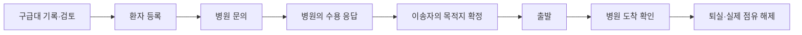

# 시스템 구조와 상태 흐름

2026-11-05 기준의 구조다. 환자·이송자와 병원 화면은 같은 Python JSON API를 호출하며 SQLite에 업무 상태를 저장한다. 화면별 실행 주소와 워커 모드는 [실행 안내](RUNNING.md)를 따른다.

## 구성

| 경로 | 역할 |
| --- | --- |
| `paramedic-ui/` | 상태 기록, 음성 인식문·초안 검토, 환자 연결 |
| `patient-ui/` | 문의·응답 확인, 목적지 확정, 출발·조건 변경·대화 |
| `hospital-ui/` | 문의 수용 판단, 도착 예정 환자·자원·제한·도착·퇴실 |
| `server/app.py` | HTTP 라우팅, 정적 화면과 JSON API 제공 |
| `server/service.py`, `server/db.py` | 업무 검증, 트랜잭션, 마이그레이션·원장 저장 |
| `server/inquiry_worker.py` | 초기 문의와 다음 문의 시점 처리 |
| `server/worker.py`, `server/planning.py`, `solver_improved.py` | 유효한 수용 후보의 배정 추천 계산 |
| `simulation/`, `inquiry_lab/` | 정책 비교·사건 재생·연구 검증 |

공통 HTTP 서버는 `ThreadingHTTPServer`로 여러 요청을 처리한다. 문의 워커와 배정 워커는 별도 백그라운드 작업이며 실행기에서 각각 켜거나 끈다. 실행 중인 상태는 `/api/system/status`로 조회한다. 별도 팀원 앱의 프레임워크는 그 앱의 README와 의존성 파일을 따른다.

## 같은 환자를 잇는 흐름

음성 초안 ID, 환자 ID, 문의 ID, 검토안 ID는 서로 다른 객체다. 초안이 등록된 뒤 반환된 환자 ID로 이송·병원 화면을 연결한다. 환자 상태는 `WAITING → CONFIRMED → IN_TRANSIT → ARRIVED → COMPLETED`를 사용하며 취소 경로도 있다. 각 수정은 대상 객체의 버전과 요청 ID를 검사한다.

병원의 수용 응답은 후보가 된다. 이송자가 목적지를 확정할 때 유효한 응답과 자원 조건을 서버에서 다시 검사한다. 이미 확정된 환자의 요구나 병원 조건이 바뀌면 해당 환자와 현재 병원이 변경안을 검토한다. 새 병원의 수용 응답을 받은 뒤 이송자가 목적지 변경을 확정한다.

## 저장과 중복 처리

| 데이터 | 핵심 객체 |
| --- | --- |
| 환자·기관·운영 자원 | `patients`, `hospitals`, `resources` |
| 문의·자동 문의 상태 | `inquiries`, `inquiry_workflows` |
| 추천 revision·결과 | `planning_state`, `planning_results` |
| 음성 초안·재시도 | `voice_sessions`, `voice_requests` |
| 이송 중 변경 검토 | `enroute_patient_reviews` |
| 대화·병원 참여 구간 | `conversations`, `conversation_hospital_sessions`, `chat_messages` |
| 사건·수신·명시 확인 | `events`, `important_event_receipts` |
| 업무 계측·통화·외부 유입 | `work_activities`, `call_records`, `external_arrivals` |

업무 상태와 관련 사건은 같은 트랜잭션에서 저장한다. 결과를 받지 못해 재시도할 때는 원래 요청 ID와 본문을 사용한다. 화면에서 사건을 표시한 기록과 담당자가 확인 버튼을 누른 기록을 구별한다. 대화 메시지와 알림 확인은 수용·목적지 변경을 대신 실행하지 않는다.

## 자료와 자원

공개 API의 기관 식별·등록 역량·가용 관측과 병원 운영 자원의 총량·점유·확정 수요를 구별한다. 오래되거나 빠진 값은 확인 대상으로 남긴다. 현재 서버 솔버의 자원 모델은 `ed_bed`와 `special_team` 두 종류다. ICU·NICU·분만실·수술실 등의 공개 관측을 이 두 자원으로 임의 변환하지 않는다.

도착 시 요구량과 실제 점유에 반영한 양을 원장에 저장한다. 퇴실에서는 그때 반영했던 양과 현재 원장을 대조해 해제한다. 과거 기록, 수동 정산, 원장 불일치가 있으면 담당자 정산 절차로 연결한다.

가상 병원 JSON 어댑터와 오류 대조는 별도 통합 시연 사본에 구현돼 있다. 적용 위치와 동일 환자 검증 근거는 [현재 상태](PROJECT_STATUS.md)와 [시연](DEMO.md)에 있다.

상세 계약은 [공통 API](API.md), [음성 API](VOICE_INPUT_API.md), [이송 조건 재확인](TRANSPORT_REVIEW.md), [자원 정산](RESOURCE_ACCOUNTING.md), [기계 판독 스키마](api/SERVER_SCHEMA_20261102.json)를 따른다. 스키마 JSON은 생성 당시의 구조 스냅샷이며 현재 선언은 `server/db.py`에서 확인한다.
