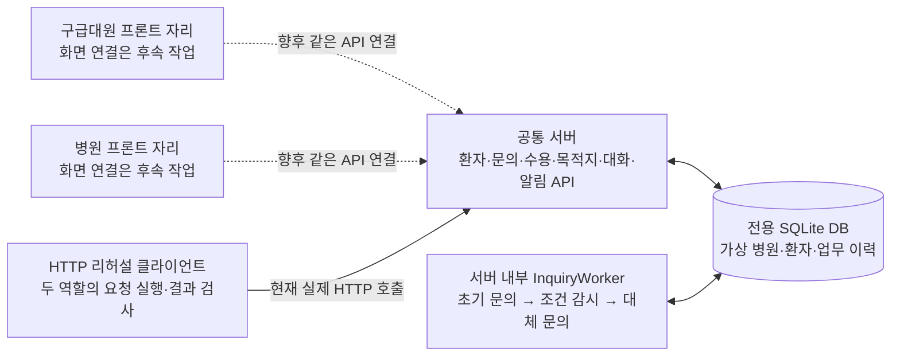
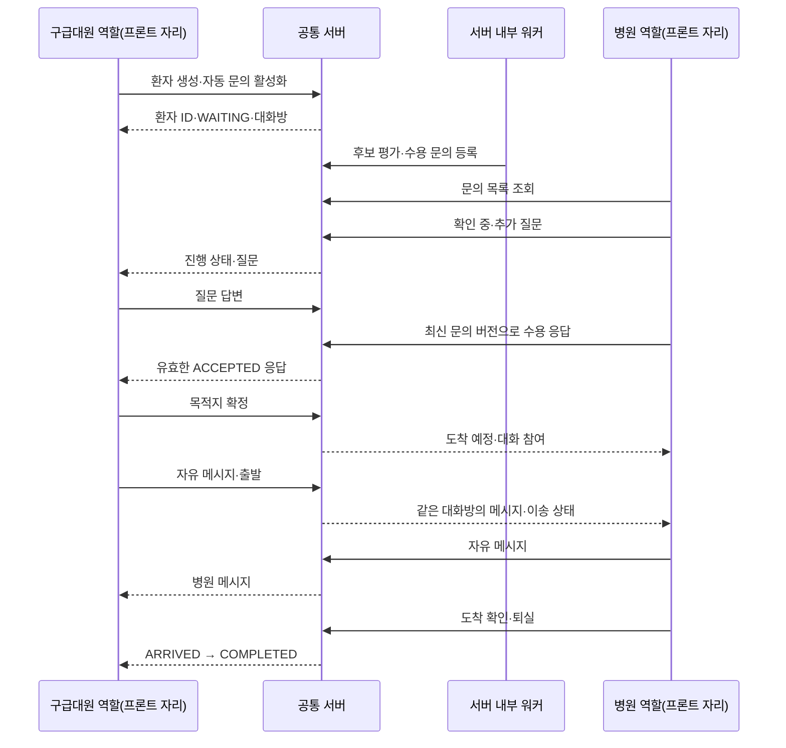
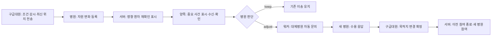

# 프론트 없이 확인하는 전체 연결 흐름

2026년 10월 29일. 구급대원 앱과 병원 웹을 비워 둔 상태에서, 공통 서버의 전체 업무 흐름을 실제 HTTP 요청으로 실행하는 연결 기준이다. `emergency-app/`, `patient-ui/`, `hospital-ui/`의 화면 코드는 수정하지 않는다.

서버의 업무 API와 자동 문의 워커는 그대로 사용한다. 리허설 클라이언트가 화면 대신 구급대원·병원 역할의 요청을 보내고, 단계별 응답과 검증 결과를 남긴다. 병원 수용·목적지 확정·조정 판단은 **가상 담당자의 동작을 대신 실행하는 것**이며, 알고리즘이 임상 판단을 자동으로 내리는 기능은 아니다.

## 1. 구성과 담당 경계



| 구성 | 이번에 제공하는 것 | 이후 연결할 것 |
|---|---|---|
| 구급대원 자리 | 환자 등록·조회·질문 답변·확정·대화·위치·변경 API | 팀원의 입력·진행·채팅·알림 화면 |
| 병원 자리 | 문의 조회·응답·질문·조건 판단·도착·퇴실 API | 팀원의 문의함·환자 상세·대화·알림 화면 |
| 공통 서버 | 기존 업무 처리와 자동 문의·재확인·대체 문의 워커 | 실제 사용자 인증·운영용 전달 구성 |
| 리허설 | 역할별 요청 순서, 성공 조건, 상태 변화, 실패 단계 기록 | 실제 사용자 조작·사용성 시험 |

이 실행은 가상 병원 `FLOW-H1`, `FLOW-H2`, `FLOW-H3`와 가상 환자를 사용한다. 공공 병원 API·카카오 API·실제 병원 연락망을 호출하지 않는다. 이동시간도 이 연결 검증에서는 거리 기반 추정이다.

## 2. 바로 실행

저장소 최상위에서 실행한다. 추가 프론트 개발 서버나 API 인증키는 필요 없다.

```powershell
python -m server.flow_rehearsal run --scenario all
```

세 사례를 전용 DB와 로컬 서버에서 실행한다. 기본 결과 디렉터리는 `outputs/flow-rehearsal/<run-id>/`다. 위치를 지정하려면:

```powershell
python -m server.flow_rehearsal run --scenario all --output outputs/flow-rehearsal/manual-check
```

사례 하나만 확인할 수도 있다.

```powershell
python -m server.flow_rehearsal run --scenario normal
python -m server.flow_rehearsal run --scenario amended
python -m server.flow_rehearsal run --scenario change
```

| 사례 | 검증 범위 |
|---|---|
| `normal` | 신규 환자 → 자동 문의 → 확인 중·질문·답변 → 수용 → 목적지 확정 → 대화 → 출발 → 도착·퇴실. 통화 기록·병원 전체 통화함·내용 확인·업무 계측 포함 |
| `amended` | 문의 후 환자정보 수정 → 수정 전 수용 응답 종료 → 오래된 화면 응답 차단 → 새 정보 재문의·수용 → 정상 이송 종료 |
| `change` | 이송 중 외부 유입 → 해당 환자 재확인 → 중요 사건 수신·확인 → 병원 조정 판단 → 자동 대체 문의 → 새 수용 → 사람이 목적지 변경 → 새 병원 도착·퇴실 |

각 실행은 새 결과 폴더를 만들며, 이미 있는 `--output` 폴더는 덮어쓰지 않는다.

| 산출물 | 내용 |
|---|---|
| `report.json` | 실행 ID, 사례별 단계·HTTP 상태·검사 결과·최종 이송 상태 |
| `report.md` | 역할·경로·결과를 읽기 쉽게 정리한 단계표 |
| `flow.db` | 그 실행의 가상 환자·문의·수용·대화·알림·계측 이력 |

실패하면 실패한 단계와 그 전까지의 기록·DB를 확인하고 해당 업무 API를 기준으로 원인을 찾는다. 리허설 소요시간은 임상 효과나 병원 선정 알고리즘의 성능 수치로 사용하지 않는다.

### API 서버만 띄우기

```powershell
python -m server.flow_rehearsal serve --db data/flow-server.db --port 18030
```

- `http://127.0.0.1:18030/`: 서버 구성·프론트 연결 자리·API 주소를 담은 JSON 안내.
- `/patient/`, `/hospital/`: `501 FRONTEND_NOT_CONNECTED`. 이번 실행에서 화면을 붙이지 않았음을 명시한다.
- `/api/...`: 기존 공통 서버의 실제 업무 API.
- 기본 바인딩은 로컬이다. 기존 운영·공공 DB를 초기화하거나 다른 업무 DB에 가상 병원을 섞지 않는다. 전용 DB를 사용하고, 호환되지 않는 기존 DB는 거부한다.

`serve`는 병원을 준비하고 문의 워커를 실행하지만 환자를 저절로 등록하거나 병원 수용을 대신 결정하지 않는다. 프론트 담당자는 이 주소의 API에 연결하면 된다. 이 실행의 CP-SAT 계획 워커는 꺼져 있으며, 솔버 패키지·외부 API 키 없이 연결 흐름을 확인한다. 알고리즘 성능 비교는 별도 실험에서 진행한다.

## 3. 정상 이송의 실제 교환



새로운 통합 업무 상태를 따로 만들지 않는다. `GET /api/patients/{pid}`가 환자 상태, `inquiries`, `inquiry_workflow`, 목적지, `transport_review`, `transport_inquiry_workflow`를 함께 제공한다. 화면은 이 응답을 기본 상태로 사용하고 대화·중요 사건을 별도 스트림으로 붙인다.

## 4. 역할별 API 연결 순서

아래 `P`는 `/api/patients/{pid}`, `H`는 `/api/hospitals/{hid}/patients/{pid}`다. 시간은 UTC epoch 초 정수이고, 요청·응답은 UTF-8 JSON이다. ID는 실제 응답에서 얻은 값을 사용한다.

| 순서·역할 | API | 주요 요청 | 다음 단계에 사용할 응답 |
|---|---|---|---|
| 1 구급대원 | `POST /api/patients` | `reporter_role: "transporter"`, `consent: true`, 환자 상태·좌표·필요 진료·자원 | `id`, `version`, `state` |
| 2 구급대원 | `POST P/inquiry-workflow` | `enabled: true`, `policy_name: "fixed_1"` | 자동 문의 상태. 이 리허설의 정책 선택이며 서비스 기본값 변경 아님 |
| 3 양쪽 | `GET P`, `GET /api/hospitals/{hid}/inquiries` | 조회 | 문의 ID·상태·`version`, 환자 요약 |
| 4 병원 | `POST /api/inquiries/{iid}/respond` | `action: "checking"` 또는 `"question"`, `handled_by`, 최신 `expected_version`; 질문이면 `question` | 변경된 문의. 확인 중은 수용 완료가 아님 |
| 5 구급대원 | `POST P/inquiries/{iid}/answer` | `answer` | 답변이 보존된 환자 상세 |
| 6 병원 | 같은 `respond` | `action: "accept"` 또는 `"decline"`, `handled_by`, 최신 `expected_version`; 불가 사유는 `reason` | 환자 쪽 문의의 `usable`, 응답 유효기간 |
| 7 구급대원 | `POST P/confirm` | `inquiry_id` | `state: "CONFIRMED"`, 목적지, 확정 당시 조건 |
| 8 양쪽 | `GET P/conversation`, `GET H/conversation` | 첫 조회 또는 커서 | `conversation`, `active_hospital_session`, `can_send`, `items`, `cursors` |
| 9 양쪽 | `POST P/messages`, `POST H/messages` | `body`, `client_message_id`, `hospital_session_id`, 선택 `sender_name` | `message`, `duplicate` |
| 10 구급대원 | `POST P/depart` | 선택 `lat`, `lon` | `state: "IN_TRANSIT"`, 도착 예정 정보 |
| 11 병원 | `POST H/arrive` | `handled_by` | `state: "ARRIVED"`, 대화 종료 |
| 12 병원 | `POST H/discharge` | `handled_by` | `state: "COMPLETED"`, 해당 건 실제 반영 자원만 해제 |

환자 생성 본문에 `auto_inquiry: true`, `inquiry_policy: "fixed_1"`을 넣으면 2번을 생성과 함께 활성화할 수도 있다. 리허설과 팀원 구현 모두 기존 서버 계약을 사용하며, 프론트에 후보 선정 루프를 별도로 만들지 않는다.

## 5. 정보 수정과 이송 중 조건 변경

### 문의 후 환자정보 수정

`WAITING`에서는 `POST P/amendments`에 다음 필드를 보낸다.

```json
{
  "actor_id": "crew-flow-1",
  "client_request_id": "amend-flow-001",
  "expected_patient_version": 1,
  "reason": "가상 환자 상태 추가 확인",
  "changes": {"symptoms": "추가로 확인한 가상 증상"}
}
```

성공 응답의 `patient`로 화면을 갱신한다. 기존 열린 문의·수용 응답은 종료되고, 워커가 활성화돼 있다면 새 버전으로 재평가한다. 환자와 문의를 재조회해 최신 버전으로 새 수용 확인을 받아야 한다. 목적지 확정 뒤 일반 정보 수정은 이 API의 지원 범위가 아니다. [전체 수정 계약](PATIENT_AMENDMENTS_API.md).

### 조건 변경 뒤 대체병원 확보



| 역할·동작 | API | 주요 필드·검사 |
|---|---|---|
| 구급대원 감시 설정 | `POST P/transport-review` | `enabled: true`, 선택 `policy_name` |
| 구급대원 위치 갱신 | `PATCH P/transport-position` | `lat`, `lon`, 선택 `measured_at`. 임상 환자 버전과 별도 위치 버전 |
| 병원 외부 유입 등록 | `POST /api/hospitals/{hid}/external-arrivals` | `request_id`, `resource_demands`, `handled_by`; 환자에게 필요한 자원의 변화 발생 |
| 양쪽 재확인 조회 | `GET P/transport-review`, 기존 병원 `incoming` | `review.state`, `version`, `risk_signature`, 대체 문의 `workflow` |
| 현재 병원 유지·조정 | `POST H/decision` | `decision: "keep"` 또는 `"adjust"`, `note`, `handled_by`, `expected_review_version`, `expected_risk_signature` |
| 새 병원 수용 | 기존 `respond` | 유효한 최신 문의에 `accept` |
| 구급대원 목적지 변경 | `POST P/change-destination` | 새 `inquiry_id`, 선택 최신 좌표. 새 수용만으로 자동 변경되지 않음 |
| 병원 외부 유입 퇴실 | `POST /api/hospitals/{hid}/external-arrivals/{eid}/discharge` | 외부 유입의 최신 `expected_version`, `handled_by`. 일반 이송 환자의 퇴실과 구분 |

리허설은 `FLOW-H1`에 외부 유입을 등록해 조건 변화를 만들고, `FLOW-H2` 수용과 명시적인 목적지 변경까지 확인한다. 외부 유입이 발생하거나 중요 사건을 확인했다는 이유만으로 목적지를 바꾸지 않는다. [조건 재확인 계약](TRANSPORT_REVIEW.md).

## 6. 보조 기능도 같은 이송 ID로 연결

| 기능 | API | 연결 시 지킬 조건 |
|---|---|---|
| 중요 사건 조회 | `GET {P 또는 H}/important-events?actor_id=...` | 일반 스트림의 `next_after_id`와 미확인 복구 조회를 구분 |
| 표시 후 수신 기록 | `POST .../important-events/{event_id}/delivered` | `actor_id`; GET만으로 수신 처리하지 않음 |
| 담당자 확인 | `POST .../important-events/{event_id}/acknowledge` | 먼저 수신된 사건에 `actor_id`. 의료적 유지·수용 결정과 별개 |
| 복귀 후 미확인 복구 | `GET .../important-events?actor_id=...&unacknowledged_only=true` | 양수 `after_id`와 함께 보내지 않음 |
| 업무 시작·종료 | `POST .../work-activities`, `POST .../work-activities/{activity_id}/stop` | 시작에 `actor_id`, `client_activity_id`, `kind`; 종료는 같은 `actor_id` |
| 통화 결과 기록 | `POST P/call-records` | 공유 대상 `hospital_id`, `actor_id`, `client_record_id`, 통화 시각·보고 결과·상대 역할 |
| 병원 전체 통화함 | `GET /api/hospitals/{hid}/call-records` | 환자 ID를 몰라도 자기 병원 기록 발견 |
| 통화 기록 내용 확인 | `POST H/call-records/{record_id}/confirmation` | `actor_id`, `client_confirmation_id`, `decision: "confirm"` 또는 `"dispute"` |

통화 메모에 `can_accept`를 기록하고 병원이 내용을 확인해도 실제 문의는 `ACCEPTED`가 되지 않는다. 반드시 구조화된 수용 응답과 목적지 확정을 거친다. 활동시간 역시 조회 대기시간이나 통화 메모의 보고 시간을 자동으로 합산하지 않는다. [계측·사건 확인](BACKEND_MEASUREMENT_API.md), [통화 기록](CALL_RECORD_API.md).

## 7. 프론트를 붙일 때의 공통 규칙

1. **기본 상태는 서버가 결정한다.** `GET P`와 병원 문의·도착 예정 조회를 기준으로 표시하고, 프론트 안에 별도 배정 상태 머신을 만들지 않는다.
2. **조회와 결정은 다르다.** 문의 전달·확인 중·수용 응답·목적지 확정을 구분한다. `usable`은 현재 확정 가능 여부이고 최종 확정 API에서 다시 검사한다.
3. **재시도 키는 유지한다.** 메시지·정보 수정·통화·활동의 같은 요청 재전송에는 최초 ID와 본문을 유지한다. 다른 내용을 같은 키로 보내지 않는다.
4. **409에서는 재조회하고 다시 판단한다.** 환자 버전·문의 버전·검토 버전·위험 해시가 바뀌면 이전 판단을 최신 값에 조용히 덮어 보내지 않는다.
5. **채팅 구간을 확인한다.** 새 병원이 참여하면 현재 `hospital_session_id`를 다시 읽는다. 이전 병원의 새 메시지는 차단되고 도착 후 방은 읽기 전용이다. 새 병원에 이전 병원 자유대화를 노출하지 않는다.
6. **복귀 때 상태를 복원한다.** 환자 상세·대화 커서·미확인 사건을 다시 조회한다. 이전 환자·병원·서버의 늦은 응답은 새 화면 상태에 반영하지 않는다.
7. **빈 프론트는 아직 연결되지 않은 것으로 표시한다.** 이번 리허설 성공을 팀원 화면 구현 완료나 실제 사용성 검증으로 표시하지 않는다.

현재 알림은 조회와 수신·확인 기록이며 OS 푸시가 아니다. `actor_id`와 경로의 병원 ID는 시연 식별자이며 로그인 인증이 아니다. 가상 역할 실행의 연결 성공과 알고리즘 간 선정 시간·문의 수·자원 배정 성능 실험은 별개로 보고한다.

## 8. 완료 기준

- 세 시나리오가 모두 실패 단계 없이 끝나고 최종 환자가 `COMPLETED`다.
- 확인 중·질문·수용·목적지 확정·출발·도착·퇴실이 서버 상태와 맞는다.
- 정보 수정 전 수용을 새 정보로 재사용하지 못한다.
- 변경된 자원이 관련 환자에 재확인을 만들고, 목적지는 새 수용과 명시적 변경 전까지 유지된다.
- 병원 참여 전·이전 병원·종료 대화의 메시지 권한이 지켜진다.
- 통화 내용 확인·알림 확인·업무 계측이 수용·이송 상태를 바꾸지 않는다.
- 기존 업무 DB와 팀원 프론트 파일은 변경하지 않는다.

구현: [실행기](../server/flow_rehearsal.py), [HTTP 역할 시나리오](../server/flow_scenarios.py). 상세 업무 계약은 [공통 API](API.md), [대화 API](CHAT_API.md), [팀원별 연결 작업](RUNNING.md)을 따른다.
