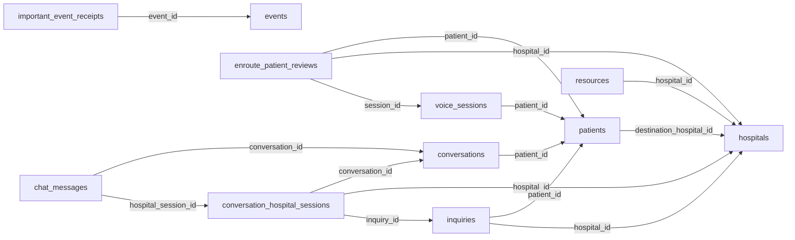

# 서버 도메인·DB 구조 인계

11월 2일 화면 담당자가 연결할 객체와 저장 구조다. 새 메모리 DB의 스키마만 읽어 작성했으며 기존 업무 DB·환자 행·음성 원문은 내보내지 않았다. 전체 열·타입·FK·인덱스는 [기계 판독 스키마](api/SERVER_SCHEMA_20261102.json)에 있다.

화면은 DB에 직접 쓰지 않고 API를 사용한다. 환자·세션·문의·검토안·대화 참여 세션의 ID/버전은 서로 다르다. 역할별 호출 순서와 본문은 [시작 절차](TEAM_START_20261102.md)의 행렬을 따른다.

## 객체별 역할

| 객체/테이블 | 역할 |
| --- | --- |
| `patients` | 환자 상태·버전·현재 목적지 |
| `hospitals` | 기관 식별과 진료 역량의 출처 |
| `resources` | 진료 자리·전문팀의 운영 수량·점유·버전 |
| `inquiries` | 환자정보 버전별 문의와 병원의 응답 |
| `inquiry_workflows` | 초기 문의 정책·다음 처리시각·마감 |
| `planning_state` | 재계산 revision·완료 revision·임시 계산 잠금 |
| `planning_results` | 환자별 계산 결과·입력 revision·만료시각 |
| `voice_sessions` | 환자 반영 전 음성 초안·명시 확인·세션 버전 |
| `voice_requests` | 음성 변경 명령의 멱등 요청·결과 |
| `enroute_patient_reviews` | 이송 중 변경 제안과 현재 병원 판단 |
| `conversations` | 같은 환자의 대화방 |
| `conversation_hospital_sessions` | 현재·과거 병원의 참여 구간 |
| `chat_messages` | 대원·병원의 자유 메시지와 중복 방지 키 |
| `events` | 서버의 업무 사건·상태 변경 이력 |
| `important_event_receipts` | 작업자별 수신과 실제 확인 기록 |
| `work_activities` | 실제 검토 활동 시작·종료 |
| `call_records` | 통화 결과·공유·정정 기록 |
| `external_arrivals` | 병원 외부 유입과 개별 종료 |

## 실제 선언된 외래키 중 핵심 관계

아래 선은 스키마에 실제 선언된 FK만 표시한다. JSON 내부 참조·코드에서 검사하는 논리 관계 전체를 의미하지 않는다.

## 수정과 반영 경계

- 음성 초안의 수정·확인은 환자정보 적용과 다르다. 명시적 submit 또는 단계에 맞는 검토·적용 절차를 거친다.
- 문의 전 WAITING 수정, 문의 후 WAITING 변경안, 확정·이송 중 현재 병원 검토는 서로 다른 경로다. `expected_version` 하나로 모든 객체 버전을 대체하지 않는다.
- 병원 수용 응답은 자원 예약·목적지 확정이 아니다. 담당자의 confirm과 서버의 원자적 자원 검사를 거친다.
- 이송 중 keep/adjust/reject 알림을 읽거나 확인해도 해당 판단을 대신 수행하지 않는다. adjust 후 새 수용·담당자 변경 전까지 현재 목적지는 유지된다.
- 3자 대화는 구급대원·확정된 현재 병원·서버 자동 사건을 뜻한다. 별도 상황실 사람이 쓰는 세 번째 계정 API는 이번 범위에 없다.
- `planning_state/results`의 계산 잠금·캐시는 백업 복원 시 재생성할 임시 상태다. 환자·수용·문의 마감시각을 복구 편의상 연장하지 않는다.

## 데이터를 다시 시작할 때

기존 DB 삭제 대신 새 DB 경로와 새 run ID를 쓴다. 합성 자료 생성은 [서버 시작 절차](TEAM_START_20261102.md), 보존 복원은 [백업 안내](TEAM_DATABASE_BACKUP_20261030.md)를 따른다. 미지원 ICU/NICU/분만/수술실 요구를 삭제하거나 진료 자리·전문팀으로 임의 치환하지 않는다.
