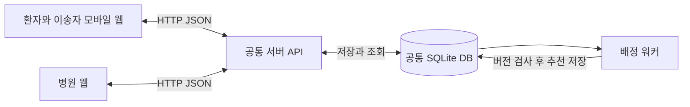
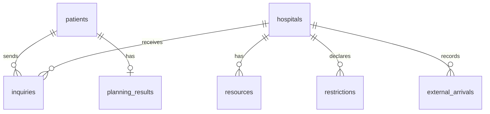

# 화면과 서버 통합 개발 기준

2026-10-29 피어리뷰 후속 작업은 [팀원별 화면 개선과 API 연결 작업](TEAM_FEEDBACK_API_HANDOFF_20261029.md)을 우선 참고한다. 현재 구현된 화면 기능과 신규 계측·알림 확인·통화 기록 연결을 구분해 정리했다.

2026-10-14 담당 경계: 환자용·병원용 앱은 각 팀원이 담당하며 현재 사용자는 해당 앱 코드를 수정하지 않는다. 공통 서버·DB·API·데이터·알고리즘·시뮬레이션과 연결 검증을 진행하고, 화면 수정이 필요한 항목은 팀원에게 전달할 계약·재현 방법·완료 기준으로 정리한다. 아래 UI 작업 목록은 팀원 담당 항목이다.

2026년 10월 13일 기준. **모바일 입력 → 병원 문의·질문·응답 → 사람의 목적지 확정·출발 → 대화 → 조건 재확인 → 대체 문의 → 사람의 목적지 변경 → 도착·퇴실**을 두 화면과 공통 서버에 연결했다. [연결본 실행과 검증](UI_INTEGRATION.md)을 먼저 확인한다. 아래 분담은 후속 개발의 기준이다.

DB와 공통 API는 이미 구현돼 있다. 화면 담당자는 공통 API를 호출하고, DB 변경과 배정 계산은 서버 담당자가 맡는다. 세부 요청·응답 형식은 [공통 API 명세](API.md), DB 구조의 원본은 [server/db.py](../server/db.py), 업무 규칙은 [server/service.py](../server/service.py)다.

진행 상황과 병원 소통은 [환자와 병원과 시스템의 대화 흐름](design/환자병원시스템_대화흐름.md)에 따라 하나의 대화 화면으로 구성한다. 탐색 중에는 시스템이 문의·회신을 알리고, 목적지 확정 후 선택 병원이 참여한다. 서버의 자유채팅 API·참여 구간·기존 사건 조회와 양쪽 화면 연결을 완료했다. 후속 변경도 [대화 API 명세](CHAT_API.md)를 따른다.

## 현재 연결 상태

2026-10-14 수동 정산 확인 후 무차감 종결 API를 추가했다. 일반 환자와 외부 유입 모두 대상·전체 자원 버전을 검사하고 담당자·사유·처리 결과를 보존한다. 병원 화면의 명시적 확인·사유 입력·감사 조회는 팀원 후속 작업이며 이번에는 UI를 수정하지 않았다. 자동 퇴실의 409를 자동 종결로 우회하지 않는다. [필드·응답·오류·연결 기준](ACCOUNTING_RECONCILIATION.md).

2026-10-14 추천 연결을 재점검했다. 모바일은 추천 API를 아직 호출하지 않고 병원은 `incoming.planning[]`를 받아도 렌더링하지 않는다. 서버는 워커 `availability`, 병원별 `eligibility_reasons`, 비활성 재계산 거부를 보강했다. UI 코드 변경 없이 기존 전체 이송과 추천 API를 독립 Chrome 컨텍스트로 검증했다. [각 팀원이 연결할 순서·완료 기준](TEAM_RECOMMENDATION_INTEGRATION.md).

추가로 팀원 최신 커밋945c413의 원본 `emergency-app/`도 공통 서버에 연결했다. 원본의 등록·상태·최종 정보 화면에서 동의 후 전송하면 아래 공통 이송 화면으로 이동한다. 개인 프로필과 이송 건은 다른 ID를 사용하며 병원 문의와 진행 상태는 공통 DB에 저장한다. 최초 위치는 원본 앱에서 브라우저 GPS 또는 직접 관측 좌표로 받고, 이송 중에는 공통 화면의 위치 갱신을 사용한다. [원본 화면 실행과 검증](TEAM_PATIENT_CONNECTION_20261013.md).

확정 이후의 [이송 조건 재확인 API](TRANSPORT_REVIEW.md)도 연결했다. 이송자 화면은 감시 시작/중지, 직접 관측 위치 갱신, 재확인·대체 문의 상태와 사람의 목적지 변경을 담당한다. 병원 화면은 incoming의 환자별 `transport_review`를 표시하고 최신 검토 버전과 위험 해시를 포함해 유지/조정 판단을 전송한다. 단순 자원 변경을 목적지 변경으로 해석하지 않는다. 기존 별도 시연 화면과 실제 역할별 연결 화면은 함께 유지한다.

초기 자동 문의 서버도 연결할 수 있다. 환자 생성 본문에 `auto_inquiry: true`를 넣으면 후보 선택과 순차적인 병렬 문의 묶음을 서버가 진행한다. 화면에서 별도의 자동 문의 루프를 만들지 않는다. 환자 상세의 `inquiry_workflow`로 진행·한도·일시정지를 표시하며, 목적지 확정은 기존 API를 사용한다. 정책은 `GET /api/inquiry-policies`의 `fixed_1`, `fixed_3`(기본), `fixed_5`, `observed_v2`, `observed_v3` 중 선택해 생성 시 `inquiry_policy`로 보낸다. 기존 작업은 일시정지 후 `policy_name`으로 변경한다. 현재 정책과 `latest_decision`, 결정 이력은 서버 조회값으로 표시한다. [연결 명세](INQUIRY_WORKFLOW.md), [요청 형식](API.md#초기-자동-문의-정책-선택).

| 영역 | 현재 상태 | 다음 작업 |
|---|---|---|
| 공통 서버와 DB | 업무 API와 `/patient/`, `/hospital/` 정적 화면 제공 | 계획 결과 표시·조건 변경 기록의 지도 연결 |
| 환자 및 이송자 화면 | `patient-ui/`의 정적 화면에서 공통 API 저장·조회·문의·이송·대화·조건 재확인 연결 | 사용성 검증, 실제 위치 관측 연계, 필요한 임상 입력 검토 |
| 병원 화면 | 문의·도착 예정·자원·돌발 유입·유지와 조정·도착·퇴실·대화·수용 제한 연결 | 외부 유입 목록·개별 퇴실과 추천 결과 표시 |
| 지도 시뮬레이션 | 저장된 실험 JSON의 독립 재생 | 운영 화면의 실시간 DB와 자동 동기화하는 기능은 별도 작업 |

현재 통합 원본은 `patient-ui/`, `hospital-ui/`다. 환자 연결본은 팀원 커밋 `181b99a613b943eed661ec8bc0f35bf9b71814d0`의 화면 표현을 이어받아 공통 API로 바꿨다. 기존 `emergency-app/`과 `.local-preview/patient-app/`는 보존했으며 그 독립 DB를 가져오지 않았다. 다음 화면 작업은 이 연결본을 기준으로 진행하고 PR에 파일 경로를 명시한다.

## 데이터가 이동하는 경로



병원 웹과 모바일 웹은 같은 서버 주소를 사용한다. 두 화면이 직접 통신하거나 각각의 DB를 동기화하는 구조가 아니다. 병원 응답을 서버에 저장하면 모바일이 조회하고, 모바일에서 목적지를 확정하면 병원 화면이 조회한다. 화면 갱신은 3초 간격 조회를 기본으로 한다.

## 공통 DB에서 알아야 할 것

| 테이블 | 보관하는 것 | 화면에서 사용하는 값 |
|---|---|---|
| `hospitals` | 병원 ID·이름·위치·진료 분야·출처 | 병원 이름, 위치, 진료 정보 |
| `resources` | 운영 자원 총량·실제 점유·상태·갱신시각·버전 | 병원 자원 상태와 수정 화면 |
| `restrictions` | 기관 전체 또는 진료 분야별 제한과 해제 상태 | 수용 제한, 만료 후 재확인 표시 |
| `patients` | 환자 입력·치료 요구·상태·목적지·ETA·조정 여부·확정 당시 조건·위치 버전 | 환자 상세와 이송 진행 |
| `inquiries` | 환자와 병원 간 문의·질문·답변·수용 응답·만료 | 양쪽 문의함 |
| `inquiry_workflows` | 초기 자동 문의 활성 상태·라운드·다음 평가·시간 한도·버전, 선택한 정책 이름·버전·설정 | 자동 탐색 상태와 중지·재개·정책 선택 |
| `inquiry_policy_decisions` | 정책별 문의 선택·대기 사유·병원 목록·관측 근거 | 최근 결정과 결정 이력 |
| `transport_reviews`, `transport_inquiry_workflows` | 확정 조건 대비 환자별 영향·병원 판단·대체 문의 회차 | 재확인 근거·감시 상태·대체 문의와 사람의 변경 대기 |
| `external_arrivals` | 시스템 밖 유입의 실제 반영 자원·활성/퇴실 상태·중복 요청 ID·처리자 | 돌발 유입 입력·목록·개별 퇴실·영향 확인 |
| `accounting_reconciliations` | 수동 정산 확인 후 무차감 종결의 원문·자원 스냅샷·처리자·사유 | 해당 병원의 종결 감사 목록·상세. 내부 원장 원문은 공개하지 않음 |
| `events` | 처리시각·처리자·환자·병원·행위·사유 | 변경 알림과 처리 이력 |
| `conversations`, `conversation_hospital_sessions`, `chat_messages` | 이송 건별 대화방·병원 참여 구간·자유메시지 | 통합 타임라인·현재 대화 병원·발송 가능 여부 |
| `planning_state`, `planning_results` | 계산 입력 버전과 추천 결과·유효기간 | 추천 대기·결과·재계산 상태 |
| `public_api_snapshots` | 공공 API 원문·정규화 값·원천 관측시각·수집시각 | 병원 참고 정보와 확인 필요 항목 |



운영 자원의 남은 수량은 실제 점유뿐 아니라 확정된 도착 예정 수요를 함께 고려한다. 화면에서 자체 계산해 DB 값을 덮어쓰지 않고 서버가 반환한 `expected`, `free`를 표시한다.

공공 자료가 있는 `data/public.db`와 화면 개발용 DB는 구분한다. 현재 공공 DB에는 병원 34곳과 공공 관측이 있으나 환자·문의·운영 자원 데이터는 비어 있다. 공개 가용병상 수를 운영 총량이나 수용 확답으로 사용하지 않는다. 첫 화면 통합은 가상 병원과 자원이 있는 별도 개발 DB에서 한다.

## 담당자별 작업과 완료 기준

### 환자 및 이송자 화면 담당

| 순서 | 작업 | 기존 API | 완료 기준 |
|---|---|---|---|
| 1 | 환자 저장 전환 | `POST /api/patients`, `GET /api/patients/{pid}`, `PATCH /api/patients/{pid}` | 인적사항·증상·의식·호흡·위치를 공통 서버에 저장하고 응답 ID로 조회. 새로고침 후 같은 환자 복구 |
| 2 | 후보와 수용 문의 | `GET .../{pid}/candidates`, `POST .../{pid}/inquiries` | 추천 이유·확인 항목·이동시간 표시. 선택한 병원에 문의를 보내고 병원 웹에서 동일 건 확인 |
| 3 | 진행 상황과 추가 질문 | 환자 상세 조회, `POST .../{pid}/inquiries/{iid}/answer`, `/retry`, `/cancel` | 3초 조회로 응답·불가 사유·질문 반영. 답변이 병원 웹에 나타남. `overdue`, `can_retry`, `usable`에 따라 화면과 버튼 변경 |
| 4 | 추천과 목적지 확정 | `GET .../{pid}/recommendation`, `POST .../{pid}/replan`, `/confirm` | 추천 상태와 실제 목적지를 구분. 유효한 수용 응답으로 확정. 만료·자원 충돌 시 오류 표시와 재조회 |
| 5 | 출발과 목적지 변경 | `POST .../{pid}/depart`, `/change-destination` | 목적지·ETA 표시. 병원 조정 요청 후 대체병원 수용을 확보하고 사람이 변경. 도착 확인을 모바일에도 반영 |
| 6 | 하나의 이송 대화창 | `GET .../{pid}/conversation`, `POST .../{pid}/messages` | 문의 진행 카드와 사건·자유메시지 통합. ID 중복 제거·커서 조회·현재 참여 구간으로 발송. 새로고침 후 같은 방 복구 |

위 1~6의 기본 흐름은 연결했다. 환자 ID와 UI 설정만 로컬에 유지하고 상세 상태는 서버에서 다시 읽는다. 직접 관측 위치는 `PATCH /api/patients/{pid}/transport-position`으로 보낸다. GPS 자동 수집은 아직 없으며 직접 입력을 자동 추적이라고 표시하지 않는다. 실제 위치 연계와 입력 항목 검토는 후속 작업이다.

입력값을 알 수 없으면 미확인으로 보낸다. 화면에서 미확인을 정상 또는 비정상으로 단정하거나 자기신고를 전문가 확인으로 바꾸지 않는다. `call_119`가 참이면 위험 신호 안내를 표시한다. 치료조건은 서버의 기존 필드와 판정 결과를 사용하며 UI에서 진단 알고리즘을 새로 만들지 않는다.

### 병원 화면 담당

| 순서 | 작업 | 기존 API | 완료 기준 |
|---|---|---|---|
| 1 | 기존 문의함 통합 확인 | `GET /api/hospitals/{hid}/inquiries`, `POST /api/inquiries/{iid}/respond` | 모바일이 새로 생성한 문의에 응답하고 모바일에서 반영 확인. 기존 가상 문의만 보여주는 것으로 끝내지 않음 |
| 2 | 도착 예정과 자원 화면 | `GET /api/hospitals/{hid}/incoming`, `GET /api/hospitals/{hid}`, `PUT .../resources/{type}` | 환자 상태·ETA·필요 자원과 운영 자원 총량·점유·예정·여유 표시. 수정 시 `expected_version` 전송, 409 후 재조회 |
| 3 | 수용 제한 관리 | `POST .../{hid}/restrictions`, `DELETE .../{hid}/restrictions/{rid}` | 제한 사유·범위·종료 예정 등록과 해제. 종료 예정이 지나면 자동 정상 복구로 표시하지 않고 재확인 필요 표시 |
| 4 | 돌발 유입과 수용 유지 판단 | `POST .../{hid}/external-arrivals`, `GET .../{hid}/incoming`, `POST .../{hid}/patients/{pid}/decision` | 돌발 유입 등록 후 영향 환자 강조. 유지 또는 조정 필요와 사유 제출. 모바일에 조정 요청이 나타나고 목적지는 즉시 바뀌지 않음 |
| 5 | 도착과 퇴실 및 추천 표시 | `POST .../{hid}/patients/{pid}/arrive`, `/no-show`, `/discharge`, `incoming.planning` | 도착·미도착·퇴실을 상태에 맞게 처리하고 점유 변화 확인. 예상 시작시각·재확인 사유와 계산 상태 표시 |
| 6 | 확정 환자의 대화창 | `GET .../{hid}/patients/{pid}/conversation`, `POST .../{hid}/patients/{pid}/messages` | 목적지 확정 후 참여. `can_send`와 구간 ID 사용. 재배정 후 이전 기록만 조회하고 새 발송 차단 |

`incoming`, `affected`, `planning`은 다른 정보다. `affected`는 자원 수량 기준 1차 영향 표시이고, 곧바로 해당 환자의 이송 불가 확정으로 표시하지 않는다. 병원에서 수용 유지 또는 조정 필요를 판단한다.

시스템 밖 유입 환자의 목록·상세·개별 퇴실 API는 2026-10-14 구현했다. 병원 웹의 기존 등록에 고정 `request_id`를 추가하고 활성 목록과 개별 퇴실을 연결한다. 운영 자원의 합계를 직접 수정하면 자동 차감이 중단되므로 외부 유입 퇴실은 해당 API를 사용한다. [요청·응답·중복·충돌 처리 기준](EXTERNAL_ARRIVALS.md). 이송 건으로 등록된 환자의 퇴실은 기존 `/patients/{pid}/discharge`를 사용한다.

### 서버와 알고리즘 담당

| 맡을 것 | 완료 기준 |
|---|---|
| DB와 요청·응답 형식 관리 | UI에서 필요한 필드와 오류를 API 명세에 반영. 필드 이름을 임의로 바꾸지 않음 |
| 공통 개발 DB와 실행 환경 | 두 화면이 같은 서버·같은 DB·같은 병원 ID를 사용하도록 제공 |
| 추천과 수용 확정 구분 | 유효한 응답·입력 버전·자원 충돌 검사. 오래된 추천과 자동 목적지 변경 방지 |
| 실제 공공 정보와 운영 상태 연결 | 출처와 갱신시각을 보존하고 미확인을 수용 가능으로 바꾸지 않음 |
| 알고리즘 비교와 시뮬레이션 | 화면 개발과 병행. 검증된 실험 정책을 운영 서버에 연결하는 작업은 별도 관리 |

관측형 문의 V2는 실험의 순수 계산 함수를 재사용하는 서버 어댑터까지 연결했다. 저장된 정책 이름·버전·설정과 결정 이력을 보존하며, 정책 루프와 관측 수집은 서버가 맡는다. 과거 첫 회신·타임아웃·미해결 문의를 쓰는 경험적 점수이므로 기존 지도 실험의 개선 수치를 서버의 성능으로 그대로 제시하지 않는다. 실제 서버 코드를 사용한 [동일 조건 합성 비교](INQUIRY_EXPERIMENT.md)는 완료했으며, 무응답·과거 상태 변화에서 실패가 확인됐다. 개선 정책의 신규 입력 평가와 현장 검증은 남아 있고, 후속 우선순위 정책은 아직 실험 엔진 기능이다. 화면 담당자는 정책 선택·진행 표시를 기존 문의·수용·확정 API와 연결한다.

## 양쪽 화면이 지킬 상태 규칙

```text
환자: WAITING → CONFIRMED → IN_TRANSIT → ARRIVED → COMPLETED
문의: PENDING → CHECKING → ACCEPTED → CONFIRMED
                         └ DECLINED
```

- **수용 응답과 목적지 확정은 다른 행위다.** 병원의 `ACCEPTED`는 최종 목적지가 아니다. 이송자가 확정 API를 호출하고 성공해야 환자가 `CONFIRMED`가 된다.
- 다른 병원을 확정하거나 응답 유효기간이 지나면 해당 응답으로 확정할 수 없다. `usable`을 사용한다.
- `needs_adjustment`가 참이어도 기존 목적지가 바로 바뀌지는 않는다. 새 병원의 수용 확인 후 이송자가 변경한다.
- 추천의 바깥 `status`인 `QUEUED`, `READY`, `STALE`, `ERROR`, `NOT_APPLICABLE`과 안쪽 `result.status`는 구분한다. `READY`가 곧 수용 확정을 뜻하지 않는다.
- 서버 시각은 UTC epoch 초다. 한국시간 표시 전에 1,000을 곱한다.
- 변경 API가 실패하면 화면만 성공 상태로 바꾸지 않는다. 서버의 오류 `message`를 표시하고 최신 상태를 다시 조회한다.
- 로그인과 계정 관리는 이번 통합 범위에서 제외한다. 테스트에는 가상 환자만 사용한다.

## 개발 시작 방법

저장소 루트에서 **개발 DB를 처음 만들 때 한 번만** 실행한다. `--seed`는 지정한 DB를 초기화하므로 기존 공공 DB에 사용하지 않는다.

```powershell
python -m server.app --db data/team-dev.db --seed --scenario inquiry --port 8000
```

그다음부터 데이터 유지 실행은 다음과 같다.

```powershell
python -m server.app --db data/team-dev.db --port 8000
```

두 화면의 API 주소를 모두 `http://127.0.0.1:8000`으로 맞춘다. UI를 제공하는 별도 웹 서버는 다른 포트를 사용한다. 병원 화면의 예시는 `hospital-ui/index.html?hid=H02&server=http://127.0.0.1:8000`이다. 서로 다른 PC에서 하나의 서버에 접속하려면 서버를 `--host 0.0.0.0`으로 실행하고 화면에서는 그 서버 PC의 LAN 주소를 사용한다. `localhost`는 각자 자신의 PC를 뜻한다.

돌발 유입을 바로 개발하려면 별도 `data/hospital-dev.db`에 `--seed --scenario in_transit`로 초기화한다. H04의 DEMO-A를 대상으로 유입 → 영향 확인 → 유지와 조정 판단을 시험한다. 두 파일에 만든 환자와 문의가 서로 공유되는 것은 아니다.

## 통합 완료를 확인하는 순서

1. 모바일에서 가상 환자를 입력하고 서버가 반환한 환자 ID를 확인한다.
2. 후보 병원에 문의를 보내고, 병원 웹에서 같은 환자 ID와 증상을 확인한다.
3. 병원에서 추가 질문을 보내고 모바일에서 답변한다. 병원 화면에서 답변을 확인한다.
4. 병원에서 수용 응답을 보낸다. 모바일에 반영되고 목적지 확정 버튼이 활성화된다.
5. 모바일에서 목적지를 확정하고 출발한다. 병원 웹에서 도착 예정과 ETA를 확인한다.
6. 병원에서 관련 자원을 소모하는 돌발 유입을 등록한다. 영향 확인 후 조정 필요를 선택한다.
7. 모바일에서 조정 사유를 확인하고 다른 병원에 문의한다. 새 수용 응답을 받은 다음 목적지를 변경한다.
8. 새 병원에서 도착과 퇴실을 처리한다. 모바일 상태와 병원 점유 수가 함께 갱신된다.

1~8의 가상 통합 흐름을 확인했다. 이후 변경에서도 같은 흐름을 유지하고 PR에는 변경한 단계, 실행 명령, 사용 서버 주소와 병원 ID, 두 화면에서 확인한 결과를 적는다. 알고리즘 효과 비교는 화면 동작 검증과 별도로 수행한다.

## 팀에 공유할 기준

이 문서·[API 명세](API.md)·서버 코드가 포함된 같은 커밋을 기준으로 작업한다. 현재 로컬에는 미커밋 서버·문서 변경이 있으므로 GitHub 화면만 보고 최신 기준을 받았다고 가정하지 않는다. 기준 브랜치와 커밋을 공유한 뒤 각 담당자가 기능 브랜치에서 작업한다. 작업 전달은 위의 순서별 기능과 완료 기준으로 하며, 전체 롱리스트를 한 번에 구현 목표로 주지 않는다.
