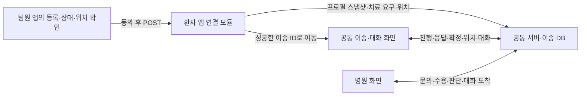

# 팀원 환자 앱 945c413 공통 서버 연결

2026-10-13 사용자 요청으로 [팀원 커밋 945c413](https://github.com/Uree1229/emergency-care-system/commit/945c413307455e7c0ce5736deb7b85a71ed1b593)의 환자 앱을 연결했다. 기존 등록·환자 선택·의식·호흡·증상·최종 정보 화면을 유지하고, 명시적 전송 후 공통 서버의 이송 화면으로 이어지게 했다. 이번에 병원 화면이나 기존 공통 서버 코드 자체는 수정하지 않았다.

## 현재 실행 중인 화면

- 원본 환자 입력 앱: `http://127.0.0.1:18026/`
- 준비된 이송 건: `http://127.0.0.1:18025/patient/?pid=MOBILE-ebe618c1f1ee480bb7d73b48eb49e424`
- 같은 건의 병원 화면: `http://127.0.0.1:18025/hospital/?hid=H04&pid=MOBILE-ebe618c1f1ee480bb7d73b48eb49e424`

가상 프로필 5에서 원본 앱의 실제 POST로 만든 시연 건이다. 소아 진료·가상 전문팀 수요로 H04 수용 확정·출발 후 전문팀 점유가 늘어 병원 재확인 상태다. 실제 의료기관이나 실제 환자의 기록이 아니다. 병원 담당자 이름과 판단 사유를 입력하고 유지/조정을 선택할 수 있다. 조정 전에 이송 화면에서 현재 관측 좌표를 갱신한다.

## 데이터와 화면 흐름

원본 `emergency.db`는 장기 보관용 개인 프로필 DB였다. 연결본도 개인 프로필과 실제 이송 건을 구분한다. 로컬 정수 프로필 ID를 공통 서버의 이송 ID로 재사용하지 않는다. 전송할 때 이름·생일·연락처·보호자와 확인된 상태의 스냅샷을 공통 DB에 저장하고 이후 진행은 공통 서버만 변경한다. 시연 프로필은 `data/teammate-profiles-demo.db`, 이송 DB는 `data/teammate-patient-demo.db`다.

## 바뀐 부분

| 부분 | 처리 |
|---|---|
| 기존 보고 화면 | GET은 저장된 병원 정보만 읽고 환자·문의는 생성하지 않음 |
| 주변 병원 조회 | 화면에서 NMC·심평원·카카오를 직접 부르던 경로를 공통 서버의 저장 정보 조회로 연결 |
| 실제 문의 시작 | `POST /emergency/connect`, 동의·입력자·관측 좌표·확인된 필요 분야를 검사 |
| 증상과 중증도 | 증상으로 치료 분야·전문가 분류를 추론하지 않고 `priority_source=unknown` 유지 |
| 의식·호흡 | yes/no/unknown 구분. 호흡 no는 abnormal이며 absent로 단정하지 않음 |
| 위치 | 브라우저 위치 API 또는 직접 관측 좌표. 미확인 위치에 예시 좌표를 자동 삽입하지 않음 |
| 전송 재시도 | UUID를 공통 이송 ID에 연결. 같은 내용 재전송은 동일 건으로 이동, 같은 ID의 다른 내용은 409 |
| 전송 실패 | 같은 ID·선택값·좌표·동의 상태의 폼으로 복구. 저장 후 응답만 유실됐으면 동일 건 조회로 복구 |
| 성공 후 | 303으로 공통 `/patient/?pid=…` 이동. 질문·응답·확정·출발·대화·감시·재배정·종료는 기존 연결 화면 사용 |

필요 진료 분야는 저장된 병원 목록에서 확인한 값을 직접 선택한다. 초기 문의 기본은 `fixed_3`이며 실험 정책·가상 전문팀 설정은 개발 시연 메뉴에 모았다. 주변 병원 5곳 미리보기는 실제 알고리즘의 문의 대상이나 탐색 한도가 아니다. 실제 문의는 공통 서버가 전체 후보와 환자 조건을 사용한다.

공공 관측과 운영 자원의 출처·시각·미확인을 구분한다. 공개 가용 수를 운영 총량이나 환자별 수용 확답으로 바꾸지 않는다. 이송 중 GPS 자동 추적은 아직 없고 공통 이송 화면의 직접 관측 위치 갱신을 사용한다.

## 파일과 원본 보관

- `emergency-app/main.py`: 기존 화면과 보고·전송 연결.
- `emergency-app/common_server.py`: 공통 API 요청, 입력 매핑, 중복 전송·응답 유실 복구.
- `emergency-app/database.py`: 프로필 DB 경로를 환경변수로 지정 가능.
- `emergency-app/README.md`: 원본 실행과 연결 방법.
- `test_patient_commit_bridge.py`: 실제 임시 HTTP·SQLite 연결 테스트.

팀원 커밋의 소스 10개 원문과 해시는 `outputs/source_snapshots/emergency_app_945c413/manifest.json`에 보존했다. 커밋의 바이너리 DB와 Python 캐시는 가져오지 않았다. `.local-preview/patient-app/`와 기존 연결 화면은 덮어쓰지 않았다. 이번 연결본은 기본 작업 폴더에서 개발한 로컬 변경이며 GitHub에 새 커밋·PR을 만들거나 push하지 않았다.

## 검증

- 연결 모듈 **12개 테스트**: 프로필·상태 매핑, 동의·좌표, 기본 문의 정책, 같은 토큰 중복·충돌, 저장 응답 유실 복구, 공공 관측 출처 보존.
- 기존 서버·대화·문의·계획·치료조건·조건 재확인 회귀를 포함해 **289개 통과**.
- 실제 Chrome **7개 검사 통과**: 원본 화면 입력, GET·새로고침의 무생성, 브라우저 위치 API 호출, 미동의 폼 복구, 실제 전송·중복/충돌, 병원 질문·수용·이송·대화, 조건 변경·재배정·도착/퇴실, 390px 표시.
- 브라우저 위치 API는 가상 좌표를 설정한 테스트 환경에서 호출 흐름을 확인했다. 실제 기기 GPS 정확도 검증은 아니다.
- 브라우저 오류·외부 사이트 요청·QA 정리 실패 0. QA의 가상 프로필은 삭제하고 해당 이송 건을 취소/퇴실 처리했으며 전용 가상 자원을 원복했다.

최종 증거는 `.codex-build/teammate-patient-20261013/tests.log`, `qa-report.json`, `original-report-390.png`, `linked-patient-{1440,390}.png`다. 최초 QA는 접힌 개발 설정을 펼치지 않아 중단됐고, 다음 QA는 대화 종료 조회 전의 버튼을 검사해 중단됐다. 시험 절차를 바로잡은 후 전체가 통과했으며 이전 기록도 같은 폴더에 보존했다.

프로세스는 공통 서버 PID11492, 환자 앱 PID21412이며 `processes.json`을 확인한다. 기존 시연 서버·DB는 유지했다. 다음에는 원본 앱의 진행 중 이송 목록/이어보기와 이송 중 위치 관측 연계, 사용성 검증을 보강할 수 있다.
