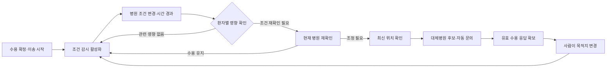

# 수용 확정 이후 조건 재확인과 대체병원 문의

2026-10-12 서버 구현, 2026-10-13 확정 당시 조건 저장 보강. 목적지가 확정되거나 이송 중인 환자의 치료 요구와 병원의 조건을 연결해 감시한다. 조건 변화가 영향을 줄 수 있으면 병원에 재확인을 요청하고, 병원이 ‘조정 필요’로 판단한 뒤 대체병원 문의를 자동 진행한다. 새 병원의 수용 응답을 확보한 뒤에도 목적지 변경은 사람이 확정한다.

## 처리 흐름



감시는 이송 건별로 명시적으로 켠다. 기존 수동 이송에는 자동으로 적용하지 않는다. 초기 `WAITING` 문의 워크플로와 이송 중 대체 문의는 별도 작업이며, 기존 문의 정책의 기본값은 계속 `fixed_3`다.

## 수용 확정 당시의 조건 보존

감시 활성화 시점과 수용 확정 시점은 다를 수 있다. `confirm`과 `change-destination`이 성공하는 트랜잭션에서 `patients.transport_baseline`에 다음을 항상 저장한다.

- 목적 병원 ID와 확정 시각 `captured_at`.
- 해당 환자의 필요 진료 분야와 자원 수요.
- 확인된 진료 역량과 관련 자원의 총량·점유·확정 수요·상태·갱신 시각·버전·신선도.
- 해당 환자에게 관련된 수용 제한.

이 저장만으로 감시를 활성화하거나 대체병원 문의를 보내지는 않는다. 감시를 나중에 켜면 저장된 확정 당시 조건과 현재 조건을 비교하므로, 그 사이 확인된 자원이 미확인으로 바뀐 경우도 찾는다. 감시를 끈 상태에서 사람이 목적지를 변경한 경우에도 새 병원의 확정 조건을 저장한다. 조건 저장 자체는 환자의 임상정보 버전을 추가로 올리지 않는다.

기존 DB의 이송 건에는 실제 확정 당시 관측이 없을 수 있다. 이 경우 과거 조건을 만들어내지 않고 첫 감시 설정 시점의 관측을 기준으로 시작한다. 따라서 이 구현 전의 변경 이력까지 소급해서 검출하는 것은 보장하지 않는다.

## 어떤 변화를 확인하는가

- 환자가 요구하는 진료 분야가 병원의 확인된 역량에서 빠지거나 상태가 미확인으로 달라진 경우.
- 환자가 요구하는 자원의 `총량−실제 점유`가 그 자원을 요구하는 모든 확정 이송의 합계보다 부족해진 경우.
- 관련 자원 정보가 미확인으로 바뀌거나, 이전에는 신선했던 정보가 600초를 초과해 오래된 경우.
- 기관 전체 또는 환자의 필요 진료 분야에 해당하는 수용 제한이 시작되거나, 종료 예정 이후 재확인이 필요한 경우.

**신규 환자용 잔여 수량 0과 기존 환자의 수용 불가능은 구별한다.** 예를 들어 자원총량2·실제점유0·확정이송수요2라면 신규 여유는0이지만 이 두 환자의 수요는 유지할 수 있다. 이 상태만으로 재확인을 요청하지 않는다.

같은 병원으로 가는 A만 특정 전문팀을 필요로 하고 B는 필요로 하지 않으면, 전문팀 부족은 A의 재확인 사유다. B는 다른 관련 조건이 바뀌지 않았다면 유지한다. 여러 환자가 같은 부족 자원을 요구하면 모두 잠재적 영향 대상으로 표시한다. 시스템이 특정 환자를 돌려보내거나 임상 우선순위를 판정하지 않는다.

확정 당시부터 미확인이었던 정보는 그대로라는 이유로 반복 알림을 만들지 않는다. 재확인 사유를 구성하는 조건의 해시를 저장하고, 병원이 유지한다고 확인한 동일 조건은 중복 알림하지 않는다. 이후 조건이 회복됐다 다시 나빠지거나 새로운 위험 사유가 생기면 다시 확인한다.

## API 연결

| 화면 동작 | API | 본문·반환 |
|---|---|---|
| 감시·대체 문의 조회 | `GET /api/patients/{pid}/transport-review` | `review`, `workflow` |
| 감시 활성화 | `POST /api/patients/{pid}/transport-review` | `{"enabled":true,"policy_name":"fixed_3"}`. 반환은 review |
| 감시·대체 문의 일시정지 | 같은POST | `{"enabled":false}` |
| 이송 위치 갱신 | `PATCH /api/patients/{pid}/transport-position` | `lat`, `lon`, 선택 `measured_at`(UTC epoch초). 반환은 환자 상세 |
| 현재 병원의 수용 유지·조정 | 기존 `POST /api/hospitals/{hid}/patients/{pid}/decision` | 아래 예시 |
| 대체병원 수용 응답 | 기존 `POST /api/inquiries/{iid}/respond` | 기존checking/accept/decline/question |
| 사람이 목적지 변경 | 기존 `POST /api/patients/{pid}/change-destination` | 유효 `inquiry_id`, 선택 현재lat/lon |

환자 상세GET에도 `transport_review`와 `transport_inquiry_workflow`가 포함된다. 병원 incoming 목록에는 환자별 `transport_review`가 포함된다. 조회는 감시를 켜거나 대체 문의를 보내지 않는다.

감시가 활성화된 환자를 병원이 판단할 때는 조회한 최신 검토 버전과 위험 해시를 함께 보낸다.

```json
{
  "decision": "adjust",
  "note": "기존 수용 조건 유지가 어려워 대체병원 확인 요청",
  "handled_by": "시연 담당자",
  "expected_review_version": 4,
  "expected_risk_signature": "조회 결과의 risk_signature"
}
```

`decision`은 `keep` 또는 `adjust`다. 현재 위험이 없으면 signature는null이다. 그 사이 관련 조건이 바뀌면 `TRANSPORT_REVIEW_CONFLICT`(409)를 반환하며, 환자 조정 플래그·판단 로그·자동 작업을 함께 롤백한다. 재조회 후 현재 조건을 다시 판단한다. 감시를 켜지 않은 기존 수동 환자는 이전 판단API 계약을 유지한다.

## 감시와 문의 상태

| 상태 | 의미 |
|---|---|
| `MONITORING` | 조건 감시, 또는 병원이 현재 수용을 유지한다고 확인 |
| `RECHECK_REQUIRED` | 변경이 이 환자에게 영향을 줄 수 있어 현재 병원 재확인 필요 |
| `SEARCHING` | 병원의adjust 이후 대체병원 자동 문의 진행 |
| `AWAITING_CHANGE` | 유효 수용 응답 확보, 사람의 목적지 변경 대기 |
| `EXHAUSTED` | 자동 탐색 한도 종료, 담당자의 추가 판단 필요 |
| `PAUSED` | 사용자가 감시와 자동 문의를 중지 |
| `COMPLETED` | 도착·취소·미도착으로 종료 |

대체 문의 작업의 `AWAITING_POSITION`은 최신 위치가 필요하다는 뜻이다. 이동 중 위치는 120초 이내 관측값을 사용한다. 위치를 갱신해도 환자의 임상정보 버전이나 수용 응답을 만료시키지 않고, 별도 `location_version`과 입력 변경 버전을 올린다. 늦게 도착한 과거 위치와 동일 시각의 상충 위치는 거부한다. 반복 전송한 같은 관측은 다시 저장하지 않는다.

대체 문의는 현재 목적 병원을 제외하고, 해당 탐색 회차에서 최대10곳·300초까지 진행한다. 초기 문의 때 닫혔던 병원도 새로운 환자 버전으로 다시 문의할 수 있다. 초기 연락 수는 이번 대체 문의 예산에 포함하지 않는다. 이미 실행 중인 같은 작업을 다시 시작해도 한도 시각을 연장하지 않는다. 이 시간·수량·위치 기준은 개발 설정이며 임상 기준이 아니다.

## 자동화 경계와 동시성

- 자원 변경을 보고 시스템이 `needs_adjustment`를 직접 설정하지 않는다. 병원의 명시적adjust 판단이 필요하다.
- 대체 문의 중에도 기존 목적지와 도착 예정 수요, 현재 병원의 대화 참여를 유지한다.
- 새 수용 응답은 후보일 뿐이다. 기존 버전·만료·제한·자원 충돌을 다시 검사한 뒤 사람의 목적지 변경API가 실제 목적지를 바꾼다.
- 병원이keep로 변경하거나 사용자가 감시를 중지하면 이번 회차의 미확정 대체 문의를 닫는다. 도착·취소·목적지 변경도 같은 트랜잭션에서 작업을 정리한다.
- 시간·문의 한도 종료는 미응답을 거절로 바꾸지 않는다. 뒤늦은 유효 수용 응답을 기존API로 확인할 수 있다.
- 이동시간 계산은 DB 쓰기 잠금 밖에서 수행한다. 적용 직전 환자·위치·감시·문의 작업 버전과 전체 입력 변경을 확인한다. 계산 중keep·도착·위치 변경이 발생하면 오래된 계산은 적용하지 않는다.

자원 수정·수용 제한·돌발 유입의 쓰기 트랜잭션에서 영향을 확인한다. 문의 워커는 예정 제한 시작과 정보 노후화도 주기적으로 확인한다. 초기 문의와 조건 재확인·대체 문의는 같은 독립 워커에서 순서대로 진행하며 솔버 작업과는 구분한다.

## 시연과 구현 파일

```powershell
python -m server.chat_demo --db data/transport-review-demo.db --port 18019
```

`http://127.0.0.1:18019/conversation-demo.html`에서 환자등록→수용응답→사람확정→출발 후 감시를 켠다. ‘조건 변경 시연’은 시스템 밖 환자 유입을 등록해 재확인 상태까지만 만든다. 병원의 유지/조정 버튼은 별도다. 조정 후 서버 문의가 도착하면 병원 응답을 시연하고, 마지막 목적지 변경도 버튼으로 따로 확정한다. ‘시연 위치 갱신’은 저장된 합성 좌표를 다시 전송하는 테스트 도구이며 실제GPS가 아니다.

소스: [transport_review.py](../server/transport_review.py), [transport_reassignment.py](../server/transport_reassignment.py), [업무 규칙](../server/service.py), [API](../server/app.py), [문의 워커](../server/inquiry_worker.py).

새 DB테이블은 `transport_reviews`, `transport_inquiry_workflows`다. 기존 DB는 초기화하지 않고 테이블 및 환자의 위치 시각·위치 버전·`transport_baseline` 필드를 추가한다. 실제 의료기관·공공DB와 연결한 운영 검증은 이번 범위에 없다. 지도에서 조건 변경 효과를 비교하는 실험도 별도 작업이다.

## 검증 결과

- 감시·대체 문의 테스트44개, 기존 서버·대화·문의·배정·치료조건·공공자료까지 포함한 최종 회귀 **276개 통과**. 최신 로그는 `.codex-build/transport-review-20261012/tests-final-20261013-approved.log`다. 이전 272개 결과는 `tests.log`에 보존했다.
- 자원 요구가 다른 A/B 영향 분리, 신규 여유0이지만 기존 수요는 유지되는 경우, 미확인·노후화·예정 제한, 유지 후 새로운 위험, 위치 버전·과거 관측 거부를 확인했다.
- 감시를 켜기 전의 자원 미확인 변경과 감시를 끈 채 목적지를 바꾸는 경우에도 확정 당시 조건을 사용함을 확인했다.
- 계산 중keep·도착·위치 변경은 이전 결과를 폐기했고, 두 워커의 동시 실행은 문의를 한 번만 만들었다. 별도 후보 병원의 자원이 계산 중 소진되어 환자·위치·현재 병원 검토 버전이 그대로인 경우에도 전체 입력 버전으로 결과를 폐기하고 새 계산에서 그 병원을 제외했다. 초기 문의 재사용·회차별 예산·기한 뒤 유효 응답·이전 병원 대화 분리도 확인했다.
- 실제 Chrome에서 별도 가상DB의 재확인→keep→새 위험→adjust→자동 대체 문의→수용→사람변경→도착을 확인했다. PC1440px·모바일390px, 새로고침 복원·브라우저 오류·가로 넘침·QA 정리 실패가 없었다. 근거는 `.codex-build/transport-review-20261012/qa-report.json`이다.
- 준비 사례의 A는 전문팀을 필요로 하고 B는 필요로 하지 않는다. 전문팀 유입을 등록한 뒤 A만 `RECHECK_REQUIRED`, B는 `MONITORING`, 둘 다 기존H04 목적지를 유지함을 실제API와 화면으로 확인했다. `.codex-build/transport-review-20261012/showcase.json`, `showcase-check.json`, `showcase-A-1440.png`, `showcase-A-390.png`에 저장했다. 준비 사례는 현재 위치가 오래되면 ‘시연 위치 갱신’을 누른 뒤 조정 판단과 대체 문의를 진행한다.

## 이전 실험 소스 보관

기존 V3 실험의 원본 보고서·잠금·감사는 수정하지 않았다. 이번 구현은 `service.py`, `db.py` 등을 변경하므로 현재 소스 지문은 당시 잠금과 달라진다. 이전 11개 소스의 원본과 지문을 `outputs/source_snapshots/inquiry_v3_20261012/`에 보존했다. 당시 감사를 현재 소스에 맞추기 위해 잠금값을 수정하지 않는다. 새로운 알고리즘 실험에는 새 개발·별도 검증 자료와 출력 파일을 사용한다.
