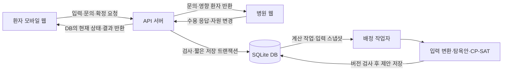

# 서버 데이터 처리 설계

작성일: 2026년 10월 5일. 서버 담당자 구현용 설계 초안.

## 1. 서버 담당자의 역할

환자·병원 화면이 보낸 데이터를 검사하고 저장한 뒤, 병원 문의와 배정 계산을 연결하고 화면이 조회할 결과를 제공한다. Python 공통 서버와 SQLite DB를 유지하면서 필요한 처리 모듈을 추가하는 방식으로 시작한다.

현재 저장소에는 환자 등록, 후보 조회, 병원 문의·응답, 목적지 확정, 출발·도착·퇴실, 돌발 유입과 이력이 구현되어 있다. 솔버 입력 변환, 시간대별 점유 데이터, 계산 작업 관리, 배정 결과 조회는 추가할 부분이다. 이 문서의 새 파일·테이블·API는 설계이며 아직 구현되지 않았다.

## 2. 전체 구조



모바일·병원 웹은 REST API로 JSON을 주고받는다. API 서버는 요청 데이터를 저장한 뒤 응답하고, 배정 작업자는 별도로 계산한다. 두 화면은 2~3초마다 현재 상태를 조회한다. HTTP 응답 한 번을 병원 수용 대기 전체에 걸쳐 유지하지 않는다.

초기에는 API 프로세스 하나, 배정 작업자 프로세스 하나, 공유 DB 파일 하나로 구성한다. 요청마다 DB 연결을 만들고 작업자도 자체 연결을 사용한다. 솔버에는 DB 연결 대신 직렬화 가능한 입력 스냅샷을 전달한다.

## 3. 모듈과 담당 기능

| 위치 | 상태 | 역할 |
|---|---|---|
| `server/app.py` | 기존 | 경로·JSON 요청 처리, 서비스 호출, HTTP 응답 |
| `server/service.py` | 기존 | 환자·문의·이송 업무 규칙, 최종 확정과 상태 변경 |
| `server/db.py` | 기존·확장 | DB 연결, 트랜잭션, 새 스키마와 마이그레이션 |
| `server/travel.py` | 기존·개선 | 이동시간 추정·지도 API 호출. 외부 호출은 쓰기 잠금 밖에서 수행 |
| `server/planning.py` | 추가 | 계산 예약, 스냅샷 작성, 결과 검증·저장, 환자별 결과 조회 |
| `server/solver_adapter.py` | 추가 | 서버 객체↔솔버 입력·출력 변환 |
| `server/worker.py` | 추가 | DB 작업 큐 확인, 중복 작업 병합, 솔버 실행·타임아웃·복구 |
| `server/calendar.py` | 추가 | 실제 점유·비가용 구간, 예정 환자를 포함한 시간대 검증 |
| `solver_improved.py` | 기존·수정 | 배정 계산. 목적지 고정/시작시각 가변 분리 필요 |

기존 API 주소와 요청·응답 필드는 유지하고 새 결과 필드를 추가한다. UI 담당자는 업무 규칙이나 솔버를 화면에 구현하지 않고, 서버가 제공한 상태·사유·결과를 표시한다.

## 4. 처리 과정

### 4.1 환자 등록

1. `POST /api/patients`에서 JSON 객체, 동의, 위치·숫자 범위, 필수 조건을 검사한다.
2. 모르는 값은 null/미확인으로 보존하고 입력된 증상을 확정 진단으로 바꾸지 않는다.
3. 짧은 트랜잭션에서 환자 ID, 최초 요청시각, 조건 버전과 `WAITING` 상태를 저장한다.
4. 환자 ID와 저장된 상태를 바로 반환한다. 현재 구현의 성공 응답은 HTTP 200이다.
5. 화면은 이 ID를 이후 문의·상태 조회에 사용한다.

등록만으로 병원 문의를 자동 전송하지 않는 기존 흐름을 유지한다. 후보 조회 후 사용자가 문의 전송을 요청하면 진행한다.

### 4.2 후보 탐색과 문의

1. `GET /api/patients/{pid}/candidates`에서 필요한 진료와 병원 역량을 비교한다.
2. 이동시간을 구하고 상태·제한·미확인 정보를 함께 제공한다. 원천 API 호출은 캐시와 호출 제한을 둔다.
3. `POST /api/patients/{pid}/inquiries`에서 선택한 병원별 문의를 한 트랜잭션에 저장한다.
4. 병원 웹은 자신의 문의 목록을 조회하고 환자 정보를 확인한다.

여기서 ‘병렬 문의’는 여러 병원의 문의를 동시에 열린 상태로 만드는 것이다. 각 병원에 별도의 네트워크 연결을 걸어 응답이 올 때까지 기다리는 구조가 아니다.

### 4.3 병원 응답과 배정 계산

1. `POST /api/inquiries/{iid}/respond`에서 문의 상태·버전·수용 제한을 검사한다.
2. 수용·불가·추가 질문을 저장하고, 배정에 영향을 주는 변경이면 같은 트랜잭션에 계산 작업을 예약한다.
3. API는 기존 응답 형태를 바로 반환한다.
4. 작업자가 일관된 입력 스냅샷을 읽고 이동시간·자원 일정·유효 수용 응답을 솔버 입력으로 변환한다.
5. 탐욕 배정안을 만들고 CP-SAT를 실행한다. 계산 중에는 DB 쓰기 잠금을 잡지 않는다.
6. 계산 결과를 검증하고 입력 버전·시간 유효성을 다시 검사한다.
7. 최신 결과만 제안으로 저장한다. 입력이 바뀌었으면 폐기 후 최신 작업을 예약한다.
8. 모바일과 병원 웹은 저장된 결과를 조회한다.

### 4.4 목적지 확정

사용자는 배정 제안을 보고 기존 `POST /api/patients/{pid}/confirm`으로 문의 ID를 보낸다. 서버는 트랜잭션 안에서 현재 환자 상태, 유효 수용 응답, 제한과 자원을 다시 검사한다. 성공하면 목적지 한 곳을 기록하고 나머지 문의를 종료한다.

추천 결과는 자원 예약이 아니다. 여러 환자의 공동 배정안에서 한 환자가 먼저 확정되면 나머지 환자 결과도 재계산한다. 현재 단계에서는 개별 확정 순서로 공동 최적해가 달라질 수 있음을 기록한다.

### 4.5 병원 변화와 이동 중 환자

자원 수정, 신규 B 유입, 출발·도착·퇴실·취소는 재계산 사건이다. 작업자는 A의 목적지를 유지하면서 새 점유와 현재 ETA로 예상 치료 시작시각을 다시 계산한다. 예상 지연은 영향 표시로 반환하고, `needs_adjustment`는 병원의 유지/조정 판단과 구분한다.

병원이 조정 필요로 판단한 뒤 대체 문의를 진행한다. 새 수용 확인 후 기존 목적지 변경 API로 확정한다. 새 목적지 기록과 이전 예정 수요 해제·이력 기록은 함께 처리하며, 계산 실패나 대안 없음으로 A의 기존 기록을 지우지 않는다.

## 5. 저장 구조

### 기존 테이블 활용

| 테이블 | 보관할 데이터 |
|---|---|
| `patients` | 환자 정보, 상태, 목적지, ETA, 조정 여부 |
| `hospitals` | 병원 위치·진료 역량·출처 |
| `resources`, `restrictions` | 자원 수량·버전·수용 제한 |
| `inquiries` | 환자–병원별 응답·만료·조건 버전 |
| `external_arrivals` | 미등록 환자 유입 사건 |
| `events` | 상태 변경 이력 |

### 추가할 데이터

| 위치 | 핵심 필드·용도 |
|---|---|
| `planning_meta` | 단일 `revision`. 배정 입력을 바꾸는 DB 쓰기마다 같은 트랜잭션에서 증가 |
| `planning_jobs` | ID, 계획 범위, 요청 revision, QUEUED/RUNNING/DONE/SUPERSEDED/FAILED, 실행 시각·작업자 lease·시도 수 |
| `planning_runs` | 작업 ID, 입력 revision, 계산 기준시각·valid_until, 솔버 상태·대체안 여부·목적값·계산시간 |
| `planning_results` | run ID, 환자 ID, 추천 병원·문의 ID, ETA, 예상 치료 시작·지연, 결과 상태·사유 |
| `resource_intervals` | 병원·자원, ACTUAL/BLOCKED, 점유 주체·수량, 시작·예상 종료·실제 종료, 출처 |
| `patients` 추가 필드 | 예상 치료시간, 허용 시작시각, 실제 치료 시작·종료. 가상·확인된 입력의 출처 포함 |

현재 `resources.occupied`와 `external_arrivals`에는 개별 점유 종료시각이 없다. 따라서 이 값만으로 미래 자원 일정을 만들 수 없다. 합성 점유 구간부터 확보하고, 기존 집계 수량과 구간의 대응을 검사한 뒤 솔버를 연결한다. 대응되지 않는 집계 점유는 별도 비가용 블록으로 처리하거나 데이터 미확인으로 반환하며 임의 종료시각을 숨겨 넣지 않는다.

`ARRIVED`는 실제 치료 시작과 구분한다. 현재 서버는 도착 시 실제 자원 수량을 증가시키지만, 그 시각을 자동으로 치료 시작시각으로 저장하지 않는다. 새 구간에는 실제 자리 점유와 모델의 치료 단계 가정을 명시한다.

예정 이송은 기존 목적지가 있는 환자로 모델링하고, 실제 점유 구간에 다시 추가하지 않는다. 공개 API 잔여 수량에서 같은 실제 점유를 또 차감하지 않는다.

새 테이블은 마이그레이션 버전으로 추가하고, 기존 가상 DB를 그대로 열어도 정상 동작하는지 확인한다. 새 컬럼이 없는 DB를 초기화 코드만으로 업그레이드했다고 가정하지 않는다.

## 6. 솔버 어댑터 계약

| 서버 데이터 | 변환 규칙·미구현 차이 |
|---|---|
| 병원 ID H01 등 | 계산마다 안정된 인덱스 매핑을 만들고 결과를 원래 ID로 복원 |
| 최초 요청·현재시각·ETA | 같은 기준시각에서 지난 정수 분. 하한은 올림, 허용 시작 상한은 내림 |
| 이동시간 초 | 분으로 올림. 이동 중은 이미 경과한 이동을 다시 더하지 않고 갱신된 ETA 사용 |
| 진료 역량·수용 응답 | 신규 환자의 eligible 생성. 미응답·만료·조건 불일치는 제외 |
| 자원 용량·점유 구간 | 진료 자리·전문팀 용량과 blocks로 변환. 이중 점유 검사 |
| 기존 확정·이동 중 환자 | 목적지만 고정하고 예상 시작은 가변. 기존 fixed와 구분할 모델 수정 필요 |
| 실제 치료 중 환자 | 실제 병원·시작 고정, 남은 점유 반영 |
| 우선순위 | 첫 실험은 4/2/1이 주어진 가상 입력. 자기신고·미확인 UI 강조를 임상 판정으로 해석하지 않음 |
| 자원 요구량 | 현재 솔버는 자리 1개·전문팀 0/1 모델. 그 밖의 수량·종류는 지원 확장 전 DATA_UNSUPPORTED |

최초 요청시각과 허용 시작시각은 재계산 때 유지한다. 기존 이송의 허용시간 초과는 영향·검토 필요로 반환하며 목적지를 삭제하지 않는다. 구체적인 목적함수와 제약은 [배정 알고리즘 초안](배정알고리즘_초안.md)을 따른다.

## 7. 결과 API 계약 — 제안, 미구현

기존 `GET /api/patients/{pid}`에 선택적 `planning` 요약을 추가하고, 상세 결과는 새 `GET /api/patients/{pid}/recommendation`에서 제공한다. 상태 조회는 저장된 결과만 읽으며 조회할 때마다 솔버를 실행하지 않는다.

```json
{
  "patient_id": "DEMO-A",
  "planning": {
    "status": "READY",
    "run_id": 12,
    "snapshot_revision": 38,
    "calculated_at": 1791172800,
    "valid_until": 1791172860,
    "solver_status": "FEASIBLE",
    "used_fallback": false
  },
  "recommendation": {
    "hospital_id": "H04",
    "inquiry_id": 6,
    "eta_at": 1791173100,
    "estimated_start_at": 1791173400,
    "confirmable_now": true,
    "reason_code": "VALID_ACCEPTANCE_AND_CAPACITY"
  },
  "impact": null
}
```

위 숫자와 결과는 형식 설명용 가상 값이다. 계산 상태, 배정 가능 여부, 환자의 이송 상태는 다른 값이다.

| planning.status | 의미·화면 처리 |
|---|---|
| IDLE | 계산 전·유효 수용 응답 대기 |
| QUEUED / RUNNING | 계산 대기·처리 중. 환자 상태는 그대로 표시 |
| READY | 현재 유효한 제안. 확정 시 다시 검사 |
| NO_ASSIGNMENT | 계산은 끝났으나 배정 없음. reason_code와 대체 행동 표시 |
| NEEDS_REVIEW | 기존 이송·점유 충돌 또는 데이터 확인 필요 |
| STALE | 입력 변경·시간 만료로 예전 결과. 확정 추천으로 사용하지 않음 |
| FAILED | 계산 처리 오류. 대체안도 없으면 오류 사유 표시 |

미배정 사유는 NO_COMPATIBLE_HOSPITAL, NO_VALID_ACCEPTANCE, CAPACITY_OR_DEADLINE, DATA_UNCONFIRMED, DATA_UNSUPPORTED 등을 구분한다. 제약 조합의 원인을 정확히 분리하지 못하면 복합 원인으로 표시한다.

현재 API가 반환하는 `usable`과 새 `confirmable_now`는 같은 확정 정책을 따라야 한다. READY라고 무조건 확정 버튼을 켜지 않는다. 계산 이후 시간이 지나거나 다른 확정이 생기면 사용 가능 여부가 달라진다.

## 8. 작업 큐·버전·시간 제한

- 배정 입력을 바꾸는 API는 데이터·revision 증가·작업 예약을 한 트랜잭션에 저장한다. 프로세스가 중간에 종료돼도 변경 사건을 잃지 않게 한다.
- 초기 계획 범위는 전체 가상 환자군 하나다. 동시에 계산을 여러 개 실행하지 않고 같은 범위의 대기 작업을 최신 revision으로 병합한다.
- 작업자는 짧은 쓰기 트랜잭션으로 작업을 하나 선점하고 lease를 기록한다. 계산은 트랜잭션 밖에서 수행한다.
- 입력을 읽을 때는 읽기 트랜잭션으로 환자·문의·자원·revision이 같은 스냅샷에 속하게 한다. 이동시간 외부 호출은 읽기 종료 후 수행하고 조회한 좌표·환자 버전을 함께 기억한다.
- 시간 경과만으로 응답 만료·정보 신선도가 바뀔 수 있다. 결과에 valid_until을 두고 만료 시 검사한다. 작업자는 만료 시점도 처리해 필요한 재계산을 예약한다.
- 결과 저장 전에 짧은 트랜잭션에서 revision과 valid_until을 검사한다. 변경됐으면 SUPERSEDED로 표시하고 재계산한다. 작업·결과 저장 자체는 입력 revision을 증가시키지 않는다.
- 서버 재시작 시 lease가 끝난 RUNNING 작업을 제한된 횟수로 재예약한다. 최신 요청이 계속 바뀌면 오래된 제안으로 확정하지 않고 계산 대기 상태를 유지한다.

솔버 예산은 초기 3초 설정으로 시작한다. 탐욕안도 같은 최신 입력과 제약으로 검사한다. 솔버가 유효한 해를 못 얻으면 검사된 탐욕안을 사용하고, 그것도 없으면 검토 필요·미배정 사유를 반환한다.

전체 작업의 강제 시간 제한은 모델 구성·초기해 생성까지 포함하도록 솔버를 별도 자식 프로세스에서 실행하고 종료를 관리한다. `Future.result(timeout=...)`만으로 실행 중 작업이 중단됐다고 가정하지 않는다. Python 문서는 실행 중 Future를 cancel로 취소할 수 없음을 명시한다. [Python 공식 문서](https://docs.python.org/3/library/concurrent.futures.html)

## 9. DB 잠금과 확정 정책

SQLite는 동시 쓰기 트랜잭션 하나만 허용한다. 현재 `BEGIN IMMEDIATE` 검사·저장 패턴을 유지하되 지도 API·솔버 실행 중 잠금을 잡지 않는다. 잠금 경합은 제한된 재시도 후 재요청 가능한 오류로 반환한다. [SQLite 공식 문서](https://www.sqlite.org/lang_transaction.html)

현재 `depart`와 `change_destination`의 이동시간 호출은 쓰기 트랜잭션 안에 있다. 개선할 때 위치·병원·버전을 먼저 읽고 잠금 밖에서 이동시간을 구한 뒤, 트랜잭션 안에서 버전을 재검사하고 ETA를 저장한다. 틀린 위치로 계산한 결과를 그대로 반영하지 않는다.

현재 수용·확정 검사는 `capacity - occupied - expected`라는 수량 기준이다. 미래에 자원이 비는 시간까지 활용하려면 수용 응답과 최종 확정도 동일한 시간대 정책으로 변경해야 한다.

단계 1은 기존 수량 검사를 유지한다. 솔버가 미래 시작 가능성을 제시해도 현재 확정 검사를 통과하지 못하면 `confirmable_now=false`로 표시한다. 단계 2에서 점유 일정 데이터와 시간대별 수용·확정 검증을 함께 도입한다. 솔버 결과만 신뢰해 기존 확정 검사를 건너뛰지 않는다.

## 10. 구현 순서와 완료 기준

| 순서 | 작업 | 완료 확인 |
|---|---|---|
| 1 | 기존 API를 두 UI와 연결 | 환자 등록→문의→수용→확정 왕복. ID·오류·상태가 양쪽에서 일치 |
| 2 | 계산에 필요한 시간·점유 데이터와 마이그레이션 | 합성 환자·병원 10곳의 입력이 어댑터 검사 통과. 집계 점유 중복 없음 |
| 3 | 어댑터 + 탐욕안 + 결과 조회 | 같은 입력에서 재현 가능한 결과, 미응답·만료 후보 제외 |
| 4 | revision·DB 작업 큐·작업자 | 계산 중 병원 상태 변경 시 오래된 결과 폐기. 재시작 후 작업 복구 |
| 5 | CP-SAT 연결과 목적지 고정/시작 가변 | 제한시간 대체안과 유효성 검사. B 유입 후 A 목적지는 유지되고 예상 시작만 변화 |
| 6 | 시간대별 수용·확정 정책 연결 | 공동 배정 이후 개별 확정·경합에서도 이중 점유 없음 |
| 7 | B0/B1/B2 실험과 예외 시연 | 동일 사건으로 지연·미배정·문의 부담·계산시간 비교 |

필수 검증은 마지막 자원 동시 확정, 만료·조건 변경 응답, 오래된 솔버 결과, 치료 구간 경계·종료 이후 점유, 신규 B 유입, 대체 병원 없음, 외부 API 오류, 계산 실패·작업자 종료다. 기존 `test_server.py`의 업무·동시성 검사를 유지하고 연결 부분의 검사를 추가한다.

첫 작업은 **기존 환자 등록과 병원 응답 API를 화면에서 왕복시키고, 그 데이터가 DB에 어떻게 저장되는지 확인하는 것**이다. 다음으로 솔버에 필요한 시간 데이터와 입력 변환을 붙인다. 배정 결과를 화면까지 전달하는 작은 흐름부터 완성한 뒤 사건별 재평가로 확장한다.

## 관련 문서

- [공통 서버 API 명세](../API.md)
- [문제 정의와 해결방안](문제정의와_해결방안_초안.md)
- [배정 알고리즘 초안](배정알고리즘_초안.md)
- [서버 구현 안내](../../server/README.md)
- [현재 구현 상태](../PROJECT_STATUS.md)
