# 응급환자 병원 배정 시스템 전체 정보 교환 명세

작성일: 2026년 10월 11일  
대상: 구급대원용 모바일 웹, 병원용 웹, 공통 서버, 배정 알고리즘 및 비교 시뮬레이션

이 문서는 시스템이 동작하는 동안 누가 누구에게 어떤 정보를 언제, 어떤 방식으로 전달해야 하는지 정의한다. 환자 등록, 후보 탐색, 병렬 문의, 병원 응답, 배정 계산, 목적지 확정, 이송, 병원 상태 변경, 재배정, 도착과 종료까지의 교환을 다룬다. 외부 데이터 확보와 알고리즘 비교 실험에서 필요한 교환도 포함한다.

아래의 ‘서버 지원’은 현재 코드에 처리 경로가 있다는 뜻이며, 모든 화면 연결이나 실제 병원 연계가 완료됐다는 의미는 아니다. 구현된 서버 계약은 [공통 API 명세](../API.md)와 [서버 코드](../../server/app.py)를 기준으로 한다. 기존 문서의 데이터 목록과 확보 방법은 부록에 유지했다.

객체 관계와 호출 순서는 [6절 객체별 상호작용 다이어그램](#6-객체별-상호작용-다이어그램)에서 확인한다. 다이어그램은 Mermaid 형식이며 GitHub 등 Mermaid를 지원하는 Markdown 화면에서 그림으로 표시된다.

## 1. 교환 주체와 통신 방식

| 주체 | 보내는 정보 | 받는 정보 | 연결 방식 |
|---|---|---|---|
| 구급대원용 모바일 웹 | 환자 상태·치료 조건·위치, 문의·확정·출발·변경·취소 요청 | 후보 병원, 병원별 진행 상황, 질문·응답, 배정 제안, 목적지와 변경 알림 | 자체 서버와 REST API로 JSON 교환 |
| 병원용 웹 | 수용 응답·질문·불가 사유, 자원·제한 변경, 수용 유지·조정 판단, 도착·퇴실 | 환자별 문의, 추가 답변, 도착 예정 환자와 ETA, 영향 환자, 문의 종료 | 자체 서버와 REST API로 JSON 교환 |
| 공통 서버와 DB | 화면별 현재 상태, 계산 입력, 외부 조회 요청 | 화면의 입력과 변경 요청, 외부 조회 결과, 계산 결과 | API 처리와 DB 저장 |
| 배정 워커와 알고리즘 | 추천 배정, 재확인 사유, 계산 상태·가정·유효기간 | 환자·병원·자원·수용 응답·이동시간의 일관된 입력 | 서버 내부 스냅샷과 계산 결과 교환 |
| 의료 공공 API | 병원 기본정보·역량·공개 가용 정보 | 지역·병원 등의 조회 조건과 인증키 | 서버에서 외부 API 호출 |
| 지도·기기 위치 기능 | 현재 위치, 경로·거리·예상 이동시간 | 위치 권한 요청, 출발지·목적지 좌표 | 기기 위치 API와 서버의 지도 API 호출 |
| 시뮬레이터와 평가 도구 | 관측 가능한 사건, 알고리즘별 결과·지표 | 시나리오, 알고리즘 종류, 정책 설정, seed | 실험 데이터와 실행 결과 파일 |

### 네 영역의 주요 상호작용

전체 설계를 모바일 웹, 서버, 병원 웹, 외부 데이터의 네 영역으로 묶었다. 서버에는 DB와 배정 알고리즘을 포함하고, 외부 데이터에는 의료 공공 API와 지도 API를 포함한다.

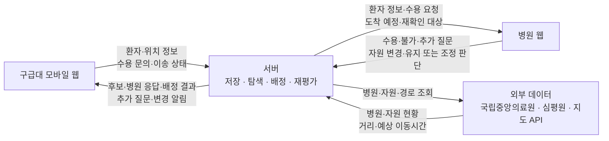

모바일 웹과 병원 웹 사이의 업무상 상호작용은 서버가 중계한다. 외부 데이터는 후보 탐색과 이동시간 계산에 활용하고, 해당 환자의 실제 수용 여부는 병원 응답으로 확인한다.

현재 화면 갱신 방식은 자체 서버를 2~3초마다 조회하는 폴링이다. 아래에서 ‘서버 → 화면’이라고 한 교환도 현재는 조회 응답으로 전달하며, WebSocket이나 모바일 푸시가 구현됐다는 뜻이 아니다. 병렬 문의는 여러 병원의 문의를 동시에 열린 상태로 저장하는 방식이다.

구현 상태 표기:

- **서버 지원**: 현재 서버 API 또는 내부 처리 경로가 있음. 화면 연결·임상 검증과는 구분함.
- **연동 필요**: 외부 서비스와 연결하거나 실제 응답·필드를 확인해야 함.
- **추가 설계**: 필요한 교환이지만 전용 API나 데이터 구조가 아직 없음.
- **실험**: 가상 시나리오와 비교 실험에 사용하는 교환임.

## 2. 단계별 전체 정보 교환

아래 X 번호는 이 문서의 정보 교환 식별자이며 기존 기능 롱리스트 ID와 별개다. 요청에는 해당 환자·병원·문의 ID를 포함하고, 성공 응답에는 처리 결과와 갱신된 상태를 돌려준다.

### 2.1 외부 정보와 병원 기준정보 확보

| ID | 시점과 교환 방향 | 보내는 정보와 받는 정보 | 방식과 처리 | 상태 |
|---|---|---|---|---|
| X01 | 초기 적재·갱신 시 서버 ↔ 국립중앙의료원 | 조회 조건 → 병원 ID·이름·주소·좌표·연락처·분류·진료 정보 | 의료 API 호출 후 내부 병원 ID에 연결 [1] | 연동 필요 |
| X02 | 초기 적재·갱신 시 서버 ↔ 심평원 | 병원 조회 조건·암호화 요양기관기호 → 기본정보·진료과·전문의 수·시설·장비 | 병원정보·상세정보 API. 보유 역량으로 저장 [2][3] | 연동 필요 |
| X03 | 가용 정보 갱신 시 서버 ↔ 의료 API | 병원·지역 등 조회 조건 → 공개 병상·수술실·중환자실·질환별 수용 정보 | 값·출처·원본 갱신 시각·조회 시각을 함께 저장 | 연동 필요 |
| X04 | 위치가 필요할 때 기기 → 모바일 웹 | 위도·경도·정확도·측정 시각 또는 권한·측정 실패 | Geolocation API. 실패 시 직접 위치 지정 | 화면 연동 필요 |
| X05 | 후보 탐색·출발·변경 시 서버 ↔ 지도 API | 출발지·후보 병원 좌표 → 거리·예상 소요시간·경로 조회 결과 | 카카오 길찾기. 실패 시 추정값과 출처 구분 [4][5] | 키 설정 시 사용 |
| X06 | 실제 병원 연계를 도입할 때 병원 내부 시스템 → 서버 | 자원 가동·점유·해제, 실제 당직·진료 제한 등의 변경과 기준시각 | 협력기관과 별도 데이터 계약. 공개 API 조회와 구분 | 추가 설계 |

API 인증키는 서버에서 관리한다. 지도 API에는 경로 계산에 필요한 좌표를 전달하며 환자 증상이나 연락처를 보낼 필요가 없다. 화면의 폴링마다 외부 의료·지도 API를 다시 호출하지 않는다.

### 2.2 환자 등록과 후보 탐색

| ID | 시점과 교환 방향 | 보내는 정보와 받는 정보 | 방식과 처리 | 상태 |
|---|---|---|---|---|
| X07 | 환자 등록 시 모바일 → 서버 | 증상·위험 신호·의식·호흡·연령 등 환자 요약, 중증도와 평가 출처, 필요한 진료·자원, 현재 좌표, 입력자·연락 정보, 현재 API의 consent 값 | `POST /api/patients`. 모르는 정보는 null·미확인으로 저장 | 서버 지원 |
| X08 | 등록 처리 후 서버 → 모바일 | 환자 ID, 상태, 버전, 저장된 정보, 입력 오류 또는 경고 | 등록 요청의 JSON 응답. 후속 조회는 이 ID 사용 | 서버 지원 |
| X09 | 첫 문의 전 모바일 ↔ 서버 | 수정 필드 → 갱신된 환자 상세와 버전 | `PATCH /api/patients/{pid}`. 현재는 문의 전 수정만 허용 | 서버 지원 |
| X10 | 문의 후·이송 중 상태 변화 시 모바일 → 서버 → 관련 병원 | 바뀐 증상·중증도·치료 조건, 변경 시각·평가 출처 → 재확인할 항목과 갱신 버전 | 별도 변경 API 필요. 기존 수용 응답의 유효성을 다시 검사 | 추가 설계 |
| X11 | 후보 조회 시 모바일 → 서버 → 모바일 | 환자 ID → 병원 목록, 거리·이동시간·출처, 추천 이유, 확인 필요 항목, 제외 사유, 후보 없음 사유 | `GET /api/patients/{pid}/candidates` | 서버 지원 |
| X12 | 다음 문의를 결정할 때 서버 ↔ 문의 정책 알고리즘 | 후보·응답 상태·경과시간·미확인 정보·정책 설정 → 문의할 병원·문의 규모·대기 또는 탐색 확대 결정 | 현재 후보 조회와 별도의 정책 계산. 자동 문의 정책의 연결 필요 | 추가 설계 |

환자 이름·생년월일·주소·보호자 정보 등 현재 API가 받는 보조 필드는 필요한 범위에서 사용한다. 배정 계산의 기본 입력은 환자의 치료 조건·우선순위·위치이며 모든 인적사항을 솔버에 전달할 필요는 없다.

### 2.3 병렬 문의와 진행 상황 공유

| ID | 시점과 교환 방향 | 보내는 정보와 받는 정보 | 방식과 처리 | 상태 |
|---|---|---|---|---|
| X13 | 문의 전송 시 모바일 → 서버 | 환자 ID, 문의할 병원 ID 목록 | `POST /api/patients/{pid}/inquiries`. 동일 병원에 진행 중인 문의가 있으면 재사용 | 서버 지원 |
| X14 | 문의 저장 후 서버 → 모바일 | 병원별 문의 ID·상태·전송 시각·문의 횟수 | 환자 상세 응답. 저장 성공을 병원 열람으로 표시하지 않음 | 서버 지원 |
| X15 | 병원 화면 조회 시 서버 → 대상 병원 웹 | 문의 ID·버전, 환자 요약·필요 조건, 경과시간·우선순위·질문·답변, 열린 문의와 종료 문의 | `GET /api/hospitals/{hid}/inquiries` 폴링 | 서버 지원 |
| X16 | 전달·열람 확인 시 병원 웹 → 서버 → 모바일 | 화면 수신 시각, 의료진의 명시적 열람 시각, 대상 문의 ID | 수신·열람 확인 API 필요. 문의 조회만으로 의료진 열람을 추정하지 않음 | 추가 설계 |
| X17 | 문의 진행 중 서버 → 모바일 | 병원별 대기·확인 중·질문·수용·불가·만료·취소 상태, 경과시간, 불가 사유, 재문의 가능 여부 | `GET /api/patients/{pid}` 폴링 | 서버 지원 |
| X18 | 새 문의나 오래된 문의가 있을 때 서버 → 병원 웹 | 새 문의 여부, 경과시간, 우선순위, 미응답 강조 대상 | 문의 목록에서 화면이 강조. 실제 알람 피로 개선 효과는 별도 평가 | 서버 지원 |

현재 알 수 있는 것은 서버에 저장된 문의 상태와 병원이 명시적으로 보낸 응답이다. ‘서버 저장 완료’, ‘병원 화면 수신’, ‘의료진 열람’, ‘확인 중 응답’, ‘수용 응답’을 같은 상태로 표시하지 않는다.

### 2.4 병원 응답과 추가 정보 확인

| ID | 시점과 교환 방향 | 보내는 정보와 받는 정보 | 방식과 처리 | 상태 |
|---|---|---|---|---|
| X19 | 검토 시작 시 병원 → 서버 → 모바일 | 문의 ID, `action=checking`, 처리자 → 확인 중 상태 | `POST /api/inquiries/{iid}/respond` | 서버 지원 |
| X20 | 추가 질문 시 병원 → 서버 → 모바일 | 문의 ID, `action=question`, 질문 내용, 처리자 → 질문 알림 | 같은 응답 API. 문의 상태는 CHECKING | 서버 지원 |
| X21 | 질문에 답할 때 모바일 → 서버 → 병원 | 문의 ID, 답변 내용 → 갱신된 질문·답변 | `POST /api/patients/{pid}/inquiries/{iid}/answer`. 병원은 목록 재조회 | 서버 지원 |
| X22 | 수용 가능 판단 시 병원 → 서버 → 모바일 | 문의 ID, `action=accept`, 처리자, 문의 버전 → 수용 상태·응답 시각·만료·경고 | 응답 API. 현재 자원·제한 검사와 환자 버전 연결 | 서버 지원 |
| X23 | 수용 불가 판단 시 병원 → 서버 → 모바일 | 문의 ID, `action=decline`, 인력·장비·병상·진료 불가·기타 사유, 처리자, 버전 → 불가 상태 | 응답 API. 해당 환자에 대한 응답으로 기록 | 서버 지원 |
| X24 | 수용 근거를 상세히 기록할 때 병원 → 서버 | 확인한 필수조건, 조건별 유지 가능 여부·추가 확인 사항, 확인 시각과 담당자 | 현재 진료 태그·자원·환자 버전보다 세분화된 구조 필요 | 추가 설계 |
| X25 | 무응답이 지속될 때 서버 → 모바일·병원 | 경과시간, 미응답 강조, 재문의 가능 여부 → 재문의 요청과 갱신 횟수 | 현 기본값 60초 강조·120초 재문의. `POST .../inquiries/{iid}/retry` | 서버 지원 |
| X26 | 수용 응답이 만료되거나 조건이 바뀔 때 서버 → 관련 화면 | 만료·재확인 사유, 더 이상 확정에 사용할 수 없다는 상태 | 현재 600초 후 EXPIRED. 환자 변경 시 버전 검사. 재문의는 현재 허용 경로로 전송 | 서버 지원·확장 필요 |
| X27 | 전화 확인을 병행할 때 구급대 ↔ 병원, 구급대 → 서버 | 전화로 확인한 수용 여부·사유·조건·담당자·시각 | 전화 연결은 외부 통신. 전화 결과를 서버에 남기는 전용 구조는 필요 | 추가 설계 |

현재 추가 질문은 문의당 question/answer 한 쌍을 저장한다. 여러 차례 대화와 각각의 발신자·시각을 보존하려면 메시지 이력 구조를 추가한다. 미응답은 수용 불가와 다르며, 전화로 얻은 응답도 시스템에 등록·확인하지 않으면 알고리즘이 알 수 없다.

### 2.5 배정 알고리즘의 입력과 결과

| ID | 시점과 교환 방향 | 보내는 정보와 받는 정보 | 방식과 처리 | 상태 |
|---|---|---|---|---|
| X28 | 배정 입력이 바뀔 때 서버·DB → 워커 | 최신 계산 revision, 환자·병원·자원·제한·유효 수용 응답·기존 목적지·ETA의 스냅샷 | 일관된 DB 입력을 읽어 비동기 계산. UI가 솔버에 직접 요청하지 않음 | 서버 지원 |
| X29 | 계산 시작 시 워커 → 알고리즘 | 후보별 적합성, 자원 용량·점유, 환자 우선순위·요구량, 이동시간, 목적지 유지 조건, 실험 시간 제약·계산 제한 | 솔버 어댑터 입력. 현재 자원 모델은 ed_bed·special_team | 서버 지원 |
| X30 | 계산 종료 시 알고리즘 → 워커·서버 | 추천 병원·문의 ID, 예상 시작·종료·대기, 미배정·재확인 사유, 대체 후보, 계산 상태·대체안 여부·가정 | 계산 결과를 입력 버전·시간 유효성 검사 후 저장 | 서버 지원 |
| X31 | 결과 조회 시 서버 → 모바일 | QUEUED·READY·STALE·ERROR 등 상태, 추천 병원, 확정 가능 여부, 계산 근거·경고·유효기간 | `GET /api/patients/{pid}/recommendation` | 서버 지원 |
| X32 | 예정 환자 재평가 조회 시 서버 → 병원 | 환자별 기존 목적지 유지 여부, 예상 시작·대기·재확인 사유·계산 상태 | `GET /api/hospitals/{hid}/incoming`의 planning | 서버 지원 |
| X33 | 수동 재계산이 필요할 때 모바일 → 서버 | 환자 ID와 재계산 요청 → 계산 대기·최신 결과 상태 | `POST /api/patients/{pid}/replan`. 매 폴링마다 호출하지 않음 | 서버 지원 |

추천은 수용 응답을 받은 후보를 평가한 제안이며 목적지 확정과 별개다. 현재 코드의 예상 치료 시작·종료는 가상 처치시간과 점유 가정에 따른 모델 출력이다. 실제 의료진의 치료 예정시각으로 표시하지 않는다. 문의 대상·규모·탐색 확대를 정하는 정책과 수용 응답 이후의 배정 계산도 구분한다.

### 2.6 목적지 확정과 출발

| ID | 시점과 교환 방향 | 보내는 정보와 받는 정보 | 방식과 처리 | 상태 |
|---|---|---|---|---|
| X34 | 목적지를 확정할 때 모바일 → 서버 | 환자 ID, 선택한 수용 문의 ID | `POST /api/patients/{pid}/confirm`. 현재 상태·응답 유효성·조건·자원을 다시 검사 | 서버 지원 |
| X35 | 확정 성공 시 서버 → 모바일·선택 병원 | 확정 병원과 연락처·좌표, 환자 CONFIRMED 상태, 도착 예정 수요 | 모바일은 처리 응답, 병원은 incoming 조회로 확인 | 서버 지원 |
| X36 | 다른 병원으로 확정됐을 때 서버 → 나머지 병원 | 해당 문의 CANCELLED, 종료 사유 | 나머지 문의를 종료하고 병원 목록 재조회로 전달 | 서버 지원 |
| X37 | 출발 시 모바일 → 서버 → 선택 병원 | 현재 좌표 → IN_TRANSIT, 출발 시각, 계산한 ETA | `POST /api/patients/{pid}/depart`. 병원은 incoming 조회. 이동시간 출처는 departed 사건 이력에 기록 | 서버 지원 |
| X38 | 이송 중 위치가 바뀔 때 모바일 → 서버 → 병원 | 현재 좌표·측정 시각·정확도 → 갱신된 ETA와 마지막 위치 갱신 시각 | 지속 위치 갱신과 ETA 재계산용 API 필요 | 추가 설계 |

수용 응답 ACCEPTED와 추천 결과는 자원 예약이 아니다. 확정한 한 곳만 서버의 도착 예정 수요로 반영한다. 현재 개별 확정 방식에서는 여러 환자의 공동 배정안이 확정 순서에 따라 달라질 수 있으므로 변경 후 재계산한다.

### 2.7 병원 상태 변경과 재배정

| ID | 시점과 교환 방향 | 보내는 정보와 받는 정보 | 방식과 처리 | 상태 |
|---|---|---|---|---|
| X39 | 자원이 변할 때 병원 → 서버 | 병원·자원 유형, 용량·실제 점유·상태, 처리자, 기대 버전 | `PUT /api/hospitals/{hid}/resources/{type}`. 수정 결과와 충돌 여부 반환 | 서버 지원 |
| X40 | 수용 제한 등록·해제 시 병원 → 서버 → 관련 화면 | 제한 범위·사유·종료 예정시각 또는 제한 해제 → 제한 상태 | `POST /api/hospitals/{hid}/restrictions`, `DELETE .../restrictions/{rid}` | 서버 지원 |
| X41 | 외부 환자가 유입될 때 병원 → 서버 | 사용 자원과 수량, 발생 시각, 메모, 처리자 → 외부 사건 ID·점유 변화·영향 환자 | `POST /api/hospitals/{hid}/external-arrivals` | 서버 지원 |
| X42 | 자원·제한 변경 후 서버 → 병원 | 관련 도착 예정 환자, 자원 부족 항목, 현재 배정 상태, 재평가 결과 | incoming의 affected·planning. 현재 affected는 수량 기준 1차 표시 | 서버 지원 |
| X43 | 조건별 영향 판단 시 서버 → 병원 | 변경된 조건과 각 환자의 수용 근거 비교, 영향을 받은 조건과 재확인 대상 | 세부 인력·장비·병상 조건별 연결 구조 필요 | 추가 설계 |
| X44 | 기존 수용 유지·조정 판단 시 병원 → 서버 → 모바일 | 환자 ID, `decision=keep` 또는 `adjust`, 설명, 처리자 → 유지 또는 조정 필요 알림 | `POST /api/hospitals/{hid}/patients/{pid}/decision` | 서버 지원 |
| X45 | 중요한 변경 알림을 확인할 때 모바일 → 서버 → 병원 | 알림 ID·확인 시각·수신자 → 확인 여부. 장시간 미확인 시 연락 필요 표시 | 알림 확인 API와 미확인 처리 정책 필요. 현재는 폴링 조회 | 추가 설계 |
| X46 | 조정 필요 후 모바일·서버 ↔ 대체 병원 | 현재 위치·최신 치료 조건 → 후보, 수용 문의, 추가 질문, 새 수용 응답 | 후보·문의·응답 흐름 재사용. 최신 위치·조건 갱신 기능 보완 필요 | 서버 지원·확장 필요 |
| X47 | 대체 목적지를 확정할 때 모바일 → 서버 | 새 수용 문의 ID, 현재 좌표 → 새 목적지·ETA·변경 결과 | `POST /api/patients/{pid}/change-destination`. 병원의 조정 요청과 새 유효 수용 응답 필요 | 서버 지원 |
| X48 | 목적지 변경 성공 시 서버 → 기존 병원·새 병원·모바일 | 기존 병원에는 이송 종료·예정 수요 해제, 새 병원에는 도착 예정·ETA, 모바일에는 새 목적지 | 변경 기록과 관련 문의 종료를 함께 반영. 화면은 최신 상태 조회 | 서버 지원 |
| X49 | 대체 병원이 없거나 계산이 실패했을 때 서버 → 모바일·병원 | 대안 없음·재확인 필요·계산 실패 사유, 기존 목적지와 이송 상태 | 기존 기록 유지. 연락·상황실 지원 판단에 필요한 정보 표시 | 기본 상태 지원·화면 설계 필요 |

신규 환자용 여유가 없어졌다는 사실과 기존 수용 환자의 조건을 유지할 수 없다는 판단은 다르다. 병원 변경 등록만으로 목적지를 자동 변경하지 않는다. 새 수용 확인 전에는 기존 목적지·예정 수요를 삭제하지 않는다. 제한 종료 예정시각이 지났다고 자동으로 수용 가능으로 바꾸지 않고 재확인 필요로 표시한다.

### 2.8 도착과 종료 및 취소

| ID | 시점과 교환 방향 | 보내는 정보와 받는 정보 | 방식과 처리 | 상태 |
|---|---|---|---|---|
| X50 | 도착 확인 시 병원 → 서버 → 모바일 | 환자·병원 ID, 처리자 → ARRIVED·도착 시각, 예정 수요를 실제 점유로 전환 | `POST /api/hospitals/{hid}/patients/{pid}/arrive` | 서버 지원 |
| X51 | 실제 치료 시작·종료 시 병원 → 서버 | 환자·치료 단계·자원, 실제 시작·종료 시각, 해제된 자원 | 실제 치료 이력과 자원별 해제 API 필요. 도착을 치료 시작으로 간주하지 않음 | 추가 설계 |
| X52 | 등록 환자 퇴실 시 병원 → 서버 → 관련 화면 | 환자 ID·처리자 → COMPLETED, 실제 점유 감소, 재계산 | `POST /api/hospitals/{hid}/patients/{pid}/discharge` | 서버 지원 |
| X53 | 외부 유입 환자의 자원 해제 시 병원 → 서버 | 외부 사건 ID, 해제 자원·수량·시각 | 현재는 자원 집계 수정으로 반영. 개별 외부 사건의 종료 API 필요 | 추가 설계 |
| X54 | 문의 또는 전체 이송 취소 시 모바일 → 서버 → 관련 병원 | 문의·환자 ID, 취소 사유 → 개별 문의 종료 또는 전체 이송 종료 | `POST .../inquiries/{iid}/cancel`은 해당 문의만 종료. `POST /api/patients/{pid}/cancel`은 관련 문의와 예정 수요도 해제 | 서버 지원 |
| X55 | 미도착 확인 시 병원 → 서버 → 모바일 | 환자 ID, 미도착 사유·처리자 → CANCELLED, 관련 문의·예정 수요 종료 | `POST /api/hospitals/{hid}/patients/{pid}/no-show` | 서버 지원 |

### 2.9 기록과 비교 실험

| ID | 시점과 교환 방향 | 보내는 정보와 받는 정보 | 방식과 처리 | 상태 |
|---|---|---|---|---|
| X56 | 상태 변경마다 서버 → DB·조회 화면 | 사건 ID·시각·처리자·환자·병원·문의·변경 내용 | events 저장. `GET /api/events`에서 대상·마지막 사건 ID로 조회 | 서버 지원 |
| X57 | 실험 준비 시 설정·데이터 → 시뮬레이터 | 병원·자원·환자·응답·외부 유입 시나리오, 알고리즘 종류, 정책 설정, seed | 동일 시나리오·seed를 알고리즘별로 실행 | 실험 |
| X58 | 시뮬레이션 진행 시 시뮬레이터 ↔ 알고리즘 | 현재까지 관측한 환자·응답·자원 변경 → 문의·대기·확정·유지·재탐색 선택 | 미래 응답·미보고 사건은 입력에서 제외. 각 선택의 시각과 근거 저장 | 실험 |
| X59 | 실험 종료 시 실행 로그 → 평가·재생 도구 | 선정·출발·도착·재배정 시각, 문의 수·미응답·미배정·변경 횟수, 계산 상태·시간 | 알고리즘별 비교 지표와 같은 사건의 진행 타임라인 생성 | 실험·재생 화면 설계 |

## 3. 모든 교환에 적용할 공통 데이터 규칙

| 구분 | 교환하거나 기록할 정보 | 적용 방식 |
|---|---|---|
| 대상 연결 | patient_id, hospital_id, inquiry_id, event_id, 외부 데이터의 출처별 병원 ID | 모든 메시지에 전부 넣는 것이 아니라 해당 교환에 필요한 ID 사용 |
| 시간 | 발생 시각, 서버 수신·처리 시각, 응답 시각, 원본 갱신 시각, 만료 시각 | 현재 API 시각은 UTC epoch 초. 화면에서 한국시간 표시. 서로 다른 사건의 시각을 섞지 않음 |
| 변경 버전 | 환자·문의·자원 version, 계산 revision, expected_version | 현재 지원 API에서는 받은 버전으로 충돌 검사. 추가 API에도 같은 원칙 적용 |
| 관측 범위 | 공개 API, 병원 입력, 구급대 입력, 전화 확인, 가상 데이터, 추정 결과 | 출처를 저장. 전화·세부 출처 구조는 추가 설계 |
| 확인 수준 | 확인됨, 미확인, 오래됨, 추가 확인 필요 | 정보 누락을 수량 0·정상·진료 불가로 변환하지 않음 |
| 성공·실패 | 처리 상태, 오류 코드·사유, 갱신된 현재 상태 | 저장 성공과 병원 수용 성공을 구분. 계산 대기도 수용 대기와 구분 |
| 중복과 재전송 | 같은 동작인지 판단할 식별 정보, 최신 처리 결과 | 현재 일부 문의·응답은 재사용·중복 처리 지원. 모든 변경 API에 범용 중복 방지가 있다고 가정하지 않음 |
| 처리자 | 병원 응답자, 상태 변경자, 평가 출처 | 현재 handled_by는 기록용이며 사용자 인증을 의미하지 않음 |

실험 설정값인 문의 병원 수·대기시간·응답 유효시간·가상 치료시간은 임상 기준과 구분한다. 예상 도착시각, 예상 치료시각, 실제 도착시각, 실제 치료시각도 별도 정보로 다룬다.

## 4. 상태와 오류를 공유하는 방식

| 대상 | 상태 또는 사건 | 양쪽 화면에 전달할 의미 |
|---|---|---|
| 환자 | WAITING → CONFIRMED → IN_TRANSIT → ARRIVED → COMPLETED, 중간 CANCELLED | 병원 문의 중·확정·이송 중·도착·종료를 구분 |
| 문의 | PENDING, CHECKING, ACCEPTED, DECLINED, CONFIRMED, EXPIRED, CANCELLED | 대기·검토·수용 응답·불가·최종 확정·만료·종료를 구분 |
| 계산 | QUEUED, READY, STALE, ERROR, NOT_APPLICABLE | 계산 대기·결과 사용 가능·오래된 결과·실패·계산 대상 아님 |
| 배정 결과 | RECOMMENDED, UNASSIGNED, DESTINATION_HELD, NEEDS_REVIEW | 제안·미배정·기존 목적지 유지·재확인 필요 |
| 충돌 | CONFLICT, RESOURCE_CONFLICT, INVALID_STATE | 최신 상태를 재조회하고 실패 이유를 표시. 확인되지 않은 변경을 성공으로 표시하지 않음 |
| 응답 유효성 | ACCEPTANCE_EXPIRED, STALE_ACCEPTANCE, NOT_ACCEPTED | 만료·환자 조건 변경·유효 수용 없음. 기존 응답으로 확정하지 않음 |
| 재문의 제한 | TOO_SOON과 wait_seconds | 재문의 가능 시각·남은 대기시간 표시 |
| 네트워크·외부 API 오류 | 마지막 동기화 시각, 조회 실패, 마지막 자료의 나이 | 연결 실패와 병원 무응답을 구분. 재접속 후 최신 상태를 조회하고 변경 요청은 중복 여부를 확인 |

현재 상태에서는 수용 확정 이후 조정 요청이 있어야 대체 문의와 목적지 변경을 진행할 수 있다. 환자 상태 변화만으로 재배정을 시작하는 확장 흐름은 별도 규칙과 API가 필요하다.

## 5. 추가로 구현할 정보 교환

1. 문의 후와 이송 중에도 환자의 상태·필수조건 변경을 관련 병원에 전달하고 재확인하는 교환.
2. 이송 중 현재 위치와 ETA를 지속 갱신하는 교환.
3. 병원 화면 수신, 의료진 열람, 중요한 변경 알림 확인을 구분하는 교환.
4. 수용 당시 조건별 근거를 저장하고 자원 변경과 연결하는 교환.
5. 다회 질문·답변 이력과 전화 수용 확인 결과를 보존하는 교환.
6. 실제 치료 시작·종료, 자원 해제 예정·실제 해제, 외부 유입 사건 종료를 전달하는 교환.
7. 문의 대상을 정하는 알고리즘의 선택을 실제 문의 전송·탐색 확대와 연결하는 교환.
8. 실제 공공 API 응답 적재와 출처·갱신 시각·오류·결측 정보를 함께 전달하는 교환.

## 6. 객체별 상호작용 다이어그램

구성 요소가 연결되는 구조는 1절의 구성도를, 각 객체가 생성·조회·변경되는 순서는 아래 그림을 기준으로 읽는다. 시퀀스 다이어그램의 실선 화살표는 호출·요청, 점선 화살표는 응답·반환이다. 아직 없는 교환은 ‘추가 설계’ 또는 ‘연동 필요’로 별도 표시한다.

| 그림 | 설명 | 관련 정보 교환 |
|---|---|---|
| 6.0 병원과 구급대의 상호작용 | 두 사용자가 문의부터 도착까지 서로 무엇을 요청하고 확인하는가 | X13~X27, X34~X55 |
| 6.1 객체 관계도 | 환자 이송 건·병원·문의·자원·계획·이력이 어떻게 연결되는가 | 전체 객체 연결 |
| 6.2 등록과 탐색 | 외부 병원 정보와 환자 입력으로 후보가 만들어지는 과정 | X01~X11 |
| 6.3 문의와 응답 | 두 병원의 병렬 문의, 추가 질문, 수용·불가·미응답 | X13~X27, X54 |
| 6.4 계산과 확정 | 배정 워커·알고리즘·DB의 계산과 구급대의 최종 확정 | X28~X36 |
| 6.5 출발과 위치 갱신 | 출발 위치로 ETA를 계산하고 병원이 도착 예정을 확인 | X37~X38 |
| 6.6 조건 변경과 재배정 | 자원 변화부터 병원의 유지·조정 판단과 대체 수용 확인까지 | X39~X49 |
| 6.7 도착과 종료 | 도착·퇴실·취소·미도착에 따른 객체와 점유 변화 | X50~X55 |
| 6.8 상태 전이 | 환자 이송 건과 수용 문의의 생명주기 | 환자·문의 상태 전체 |
| 6.9 비교 실험 | 시나리오·관측 정보·알고리즘 선택·평가 결과의 연결 | X56~X59 |

### 6.0 병원과 구급대의 업무상 상호작용

병원 담당자와 구급대원은 서로 수용을 문의하고, 부족한 정보를 확인하고, 이송을 확정하고, 조건 변화를 조정한다. 이 업무 관계는 서버를 거쳐 구현된다. 실제 통신 구조는 `구급대 모바일 웹 ↔ 공통 서버 ↔ 병원 웹`이며 두 브라우저가 직접 연결되는 구조는 아니다.

아래 두 그림은 업무의 발신자와 수신자가 보이도록 서버를 생략했다. 화살표는 서버에 저장한 요청·응답을 상대 화면이 조회해 확인하는 과정을 포함한다. 수용 확정·취소·목적지 변경의 결과도 서버가 관련 화면에 반영하며, 구급대원이 각 병원에 별도로 같은 메시지를 보내야 한다는 뜻은 아니다.

| 시점 | 구급대에서 병원으로 | 병원에서 구급대로 | 현재 범위 |
|---|---|---|---|
| 최초 문의 | 환자 요약, 필요한 치료 조건, 수용 요청 | 확인 중 응답 | 서버 지원, 병원 문의 화면 연결 |
| 추가 확인 | 병원이 질문한 내용에 대한 답변 | 추가 질문 | 서버 지원. 문의당 질문·답변 한 쌍이며 자유 채팅은 아님 |
| 수용 판단 | 필요한 추가 정보 | 수용 가능 또는 불가와 사유 | 서버 지원, 병원 응답 화면 연결 |
| 목적지 확정 | 선택 병원에는 이송 확정, 다른 병원에는 문의 종료 | 도착 예정 환자로 확인 | 서버 지원. 모바일과 병원 도착 예정 화면 연결 필요 |
| 출발 | 출발 상태와 ETA | 도착 예정 환자 확인 | 서버 지원. 화면 연결 필요 |
| 이송 중 환자 변화 | 바뀐 증상·중증도·치료 조건 | 변경된 조건의 수용 가능 여부 재확인 | 문의 이후 환자 변경과 전달은 추가 설계 |
| 병원 조건 변화 | 변경 알림을 확인하고 대안 판단 | 해당 환자 수용 유지 또는 조정 요청과 설명 | 서버 지원. 병원 판단 화면 연결과 알림 확인 API 필요 |
| 목적지 변경 | 새 병원에는 이송 확정, 기존 병원에는 도착 예정 해제 | 대체 병원의 새 수용 응답 | 서버 지원. 새 수용 확인과 사람의 변경 결정 필요 |
| 도착 | 실제 이송과 인계 | 도착 확인 | 도착 확인 API 지원. 도착·인계의 실제 행위와 화면 기록은 구분 |
| 취소·미도착 | 취소 사유와 이송 종료 | 미도착 처리와 사유 | 서버 지원. 관련 화면 연결 필요 |

**초기 문의에서 도착까지**

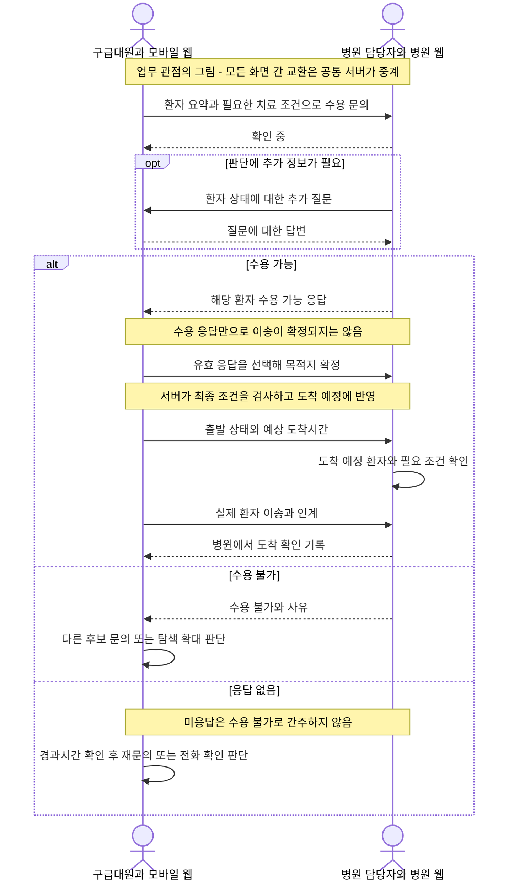

**수용 확정 이후 병원 조건이 달라졌을 때**

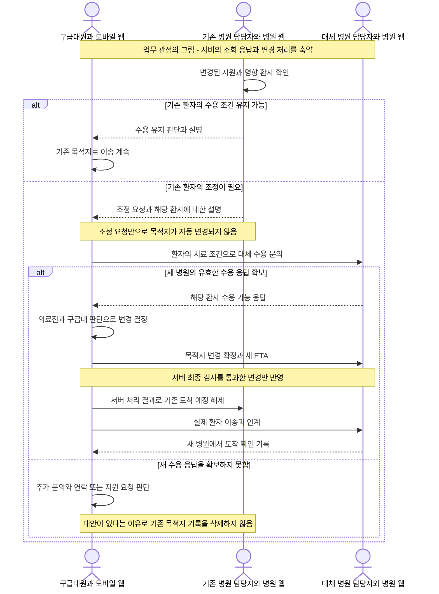

병원 화면 수신·의료진 열람·구급대의 중요 알림 확인은 각각 별도 교환이다. 현재 폴링으로 상태를 조회하는 기능이 상대 사용자의 확인 ACK를 대신하지 않는다. 지속 위치 갱신, 이송 중 환자 조건 변경, 조건별 수용 근거 추적은 추가 설계 항목으로 유지한다.

### 6.1 객체 관계도

현재 데이터 구조를 기준으로 한 관계도다. PATIENT는 환자 인적사항만이 아니라 환자 한 명의 이송 한 건을 함께 저장한다. 현재 목적지와 이송 상태도 이 객체의 필드이며 별도의 예약 객체는 없다.

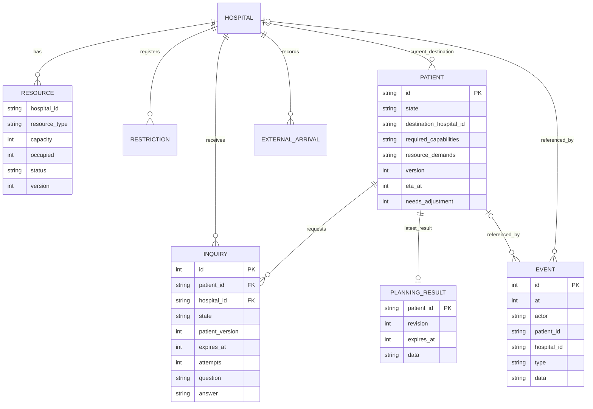

| 객체 | 담당하는 정보와 동작 | 관계에서 주의할 점 |
|---|---|---|
| PATIENT 환자 이송 건 | 치료 조건·현재 상태·목적지·ETA·조정 필요 여부 | 현재 목적지는 없거나 한 곳. 변경 이력은 사건 로그에 기록 |
| HOSPITAL 병원 | 위치·진료 역량·출처별 식별자 | 여러 문의와 자원·제한 현황을 가짐 |
| INQUIRY 수용 문의 | 한 환자와 한 병원의 요청·질문·응답·유효기간 | 동일 환자·병원 조합은 한 행. 재문의는 기존 행과 attempts를 갱신 |
| RESOURCE 자원 현황 | 자원 유형별 총량·실제 점유·상태·버전 | 병원·자원 유형이 복합키. 도착 예정 수요는 환자 상태에서 계산 |
| RESTRICTION 수용 제한 | 적용 범위·사유·시작·종료 예정·해제 여부 | 종료 예정 경과만으로 해제되지 않음 |
| EXTERNAL_ARRIVAL 외부 유입 | 시스템 밖 환자가 사용한 자원과 발생·등록 시각 | 개별 외부 유입의 종료 API는 추가 설계 |
| PLANNING_RESULT 배정 제안 | 환자별 최신 추천·재평가 결과 | 환자당 최신 한 건. 전체 계산 실행 이력이 누적되는 테이블은 아님 |
| EVENT 사건 이력 | 누가 언제 어떤 환자·병원의 상태를 바꿨는지 | 환자·병원 ID는 선택적 참조. 현재 SQL 외래키로 강제되지는 않음 |

관계도의 한쪽 원은 0개를 허용하고, 세 갈래 표시는 여러 개를 뜻한다. 조건별 수용 근거, 다회 대화 메시지, 열람 확인은 앞으로 추가할 객체이며 현재 구현된 독립 테이블로 표시하지 않았다.

### 6.2 병원 정보 확보와 환자 등록 및 후보 탐색

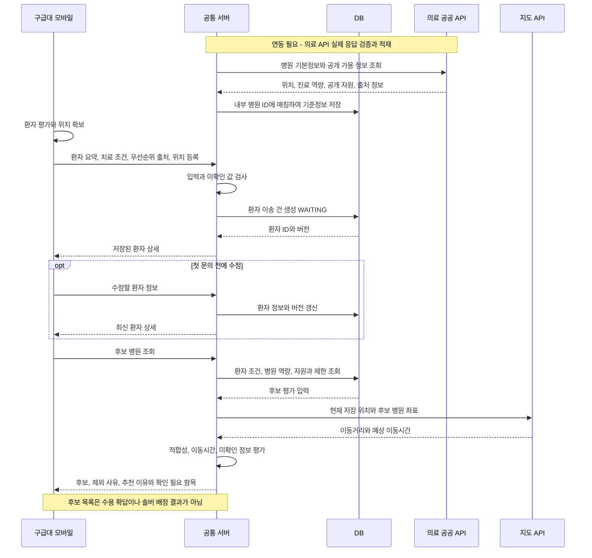

### 6.3 병렬 문의와 병원 응답

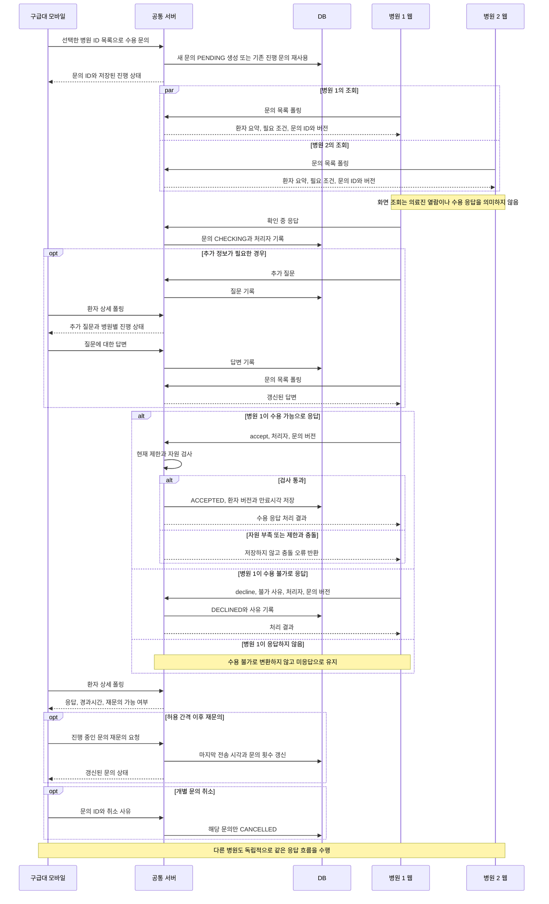

실제 문의 목록 수신 확인이나 의료진의 열람 확인은 별도의 ACK 교환이 필요하다. 현재는 CHECKING처럼 병원이 명시적으로 보낸 응답만 확실한 검토 상태로 전달한다.

### 6.4 배정 계산과 목적지 확정

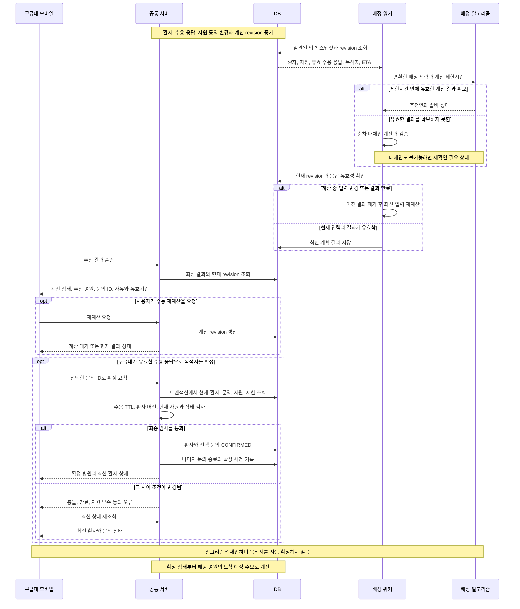

최종 확정에는 솔버 추천이 필수는 아니며, 현재 서버는 유효한 병원 수용 응답을 직접 선택해 확정하는 경로도 지원한다. 병원 ACCEPTED 응답과 배정 제안은 자원 예약이 아니다. 문의 대상과 규모를 자동 선택·전송하는 정책도 이 배정 워커와 별도로 연결해야 한다.

### 6.5 출발과 도착 예정 공유

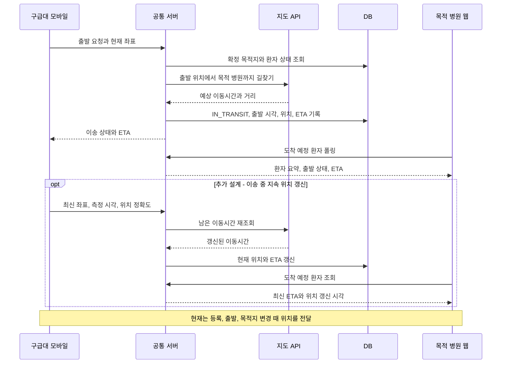

### 6.6 병원 자원 변경과 조건 재확인 및 재배정

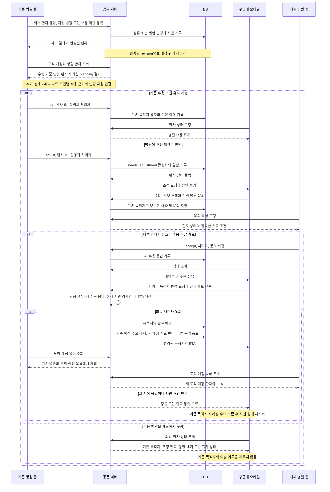

자원 변경만으로 needs_adjustment가 자동 활성화되거나 목적지가 바뀌지 않는다. 위 대체 후보 탐색에 이송 중 최신 위치와 변경된 환자 조건을 반영하는 연결은 추가 설계다. 현재 목적지 변경 API에는 실제 변경 시점의 좌표를 전달할 수 있다.

### 6.7 도착과 자원 점유 전환 및 종료

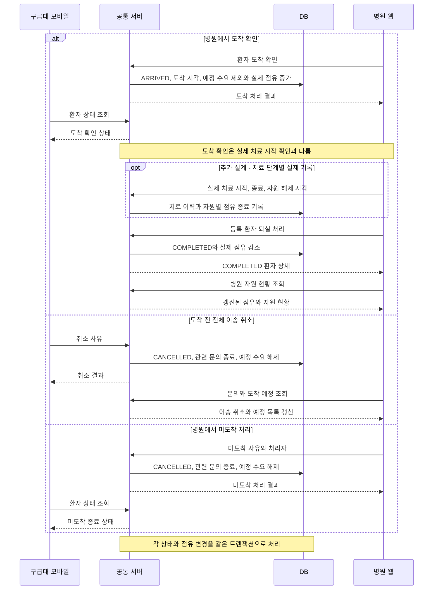

실제 치료 기록을 도입할 때는 치료 종료에 따른 자원 해제와 퇴실에 따른 자원 해제가 중복되지 않도록 계약을 확장해야 한다. 현재 퇴실 동작은 등록 환자의 점유를 해제하며, 외부 유입 사건의 개별 종료는 별도 설계 대상이다.

### 6.8 환자 이송 건과 문의 객체의 생명주기

환자 이송 건은 다음 상태를 갖는다. 조정 판단과 목적지 변경은 CONFIRMED 또는 IN_TRANSIT 안에서 조정 필드와 목적지가 바뀌는 동작이다. 현재 모델에 별도 REASSIGNING 상태는 없다.

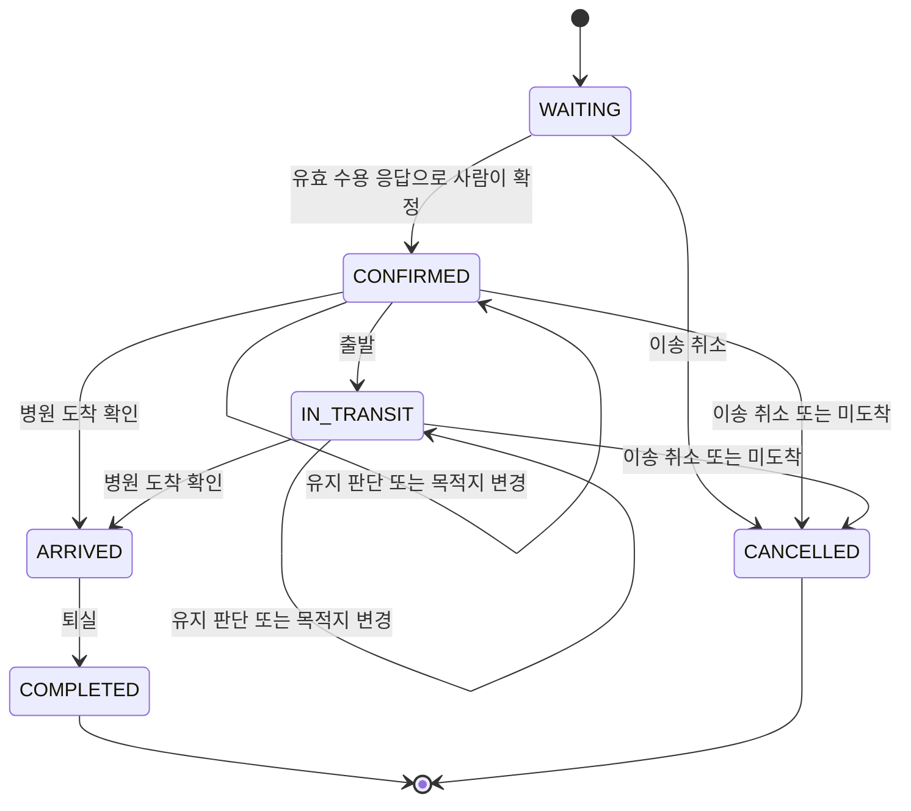

수용 문의의 생명주기는 다음과 같다. 열린 문의의 retry는 문의 상태와 최소 간격을 검사한다. 종료된 문의를 다시 전송하는 경로는 환자의 현재 상태와 조정 필요 여부도 검사한다.

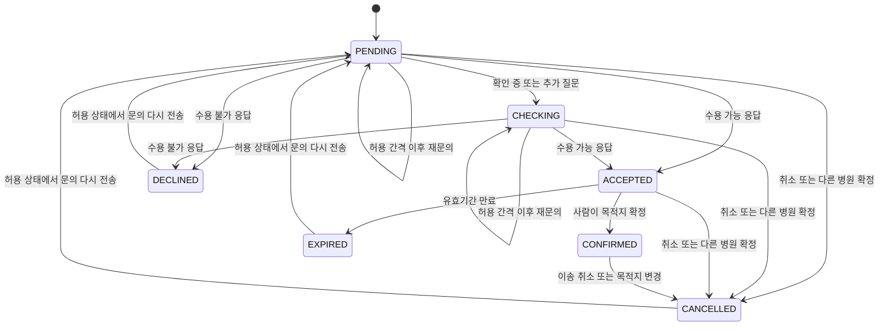

만료된 응답의 재확인은 열린 문의에 쓰는 retry API와 구분한다. 현재는 문의 전송 API가 종료된 해당 환자·병원 조합의 행을 다시 PENDING으로 사용할 수 있다.

### 6.9 알고리즘 비교와 시뮬레이션 객체의 상호작용

비교 실험의 목표 구조다. 알고리즘은 현재까지 관측한 정보로 선택하고, 시뮬레이터가 관리하는 전체 미래 사건은 직접 읽지 않는다. 진행 상황을 재생하는 화면은 추가 설계다.

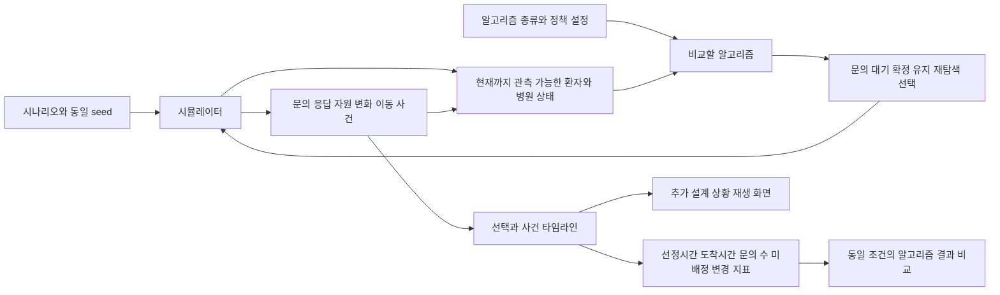

## 부록 A. 환자와 구급대에서 받아야 하는 정보

| ID | 필요한 정보 | 구체적인 항목 | 획득 방법 | 활용 목적 |
|---|---|---|---|---|
| P01 | 환자의 현재 위치 | 위도·경도, 위치 정확도, 측정 시각 | 모바일 웹의 Geolocation API. 실패 시 지도에서 직접 지정 | 초기 후보 탐색, 이송 중 대체병원 탐색 |
| P02 | 환자의 상태 | 주요 증상, 연령, 의식·호흡 상태. 필요한 경우 활력징후, 임신 주수 등 | 구급대원이 모바일 웹에 입력 | 병원의 수용 판단에 필요한 정보 전달 |
| P03 | 중증도와 우선순위 | 구급대의 중증도 평가, 평가 시각, 상태 변화 | 구급대 입력과 필요한 의료진 확인 | 다수 환자의 배정 우선순위 판단 |
| P04 | 필요한 치료 조건 | 필요한 진료 분야, 전문인력, 장비, 병상 종류 | 구급대 평가와 의료진 확인을 바탕으로 구조화해 입력 | 적합한 병원 필터링, 조건 변경의 영향 판단 |
| P05 | 이송 진행 상태 | 출발, 이송 중, 도착, 현재 위치, 환자 상태 변경 | 구급대 입력과 위치 갱신 | 예상 도착시간 갱신, 배정 재평가 |

Geolocation API는 사용자 권한을 받아 현재 위치와 위치 변화를 제공한다. 실제 모바일 웹 서비스에서는 HTTPS 환경을 사용한다. [Geolocation 문서](https://developer.mozilla.org/ko/docs/Web/API/Geolocation)

치료 조건은 환자마다 필요한 항목만 지정한다. 예를 들어 고위험 산모는 고위험 분만 대응과 필요한 신생아 치료 역량을 확인한다. 증상만으로 시스템이 진단이나 중증도를 확정하는 구조로 만들지 않는다. 입력하지 않은 정보를 정상 또는 불필요로 간주하지 않는다.

## 부록 B. 공개 API로 확보할 정보

| ID | 필요한 정보 | 구체적인 항목 | 획득 방법 | 활용 범위와 한계 |
|---|---|---|---|---|
| A01 | 응급의료기관 기본정보 | 병원명, 주소, 좌표, 응급실 전화, 응급의료기관 분류 | 국립중앙의료원 전국 응급의료기관 정보 조회 API [1] | 전국 후보 병원 목록 구성 |
| A02 | 병원 기본정보와 식별자 | 병원 기본현황, 암호화 요양기관기호 | 심평원 병원정보서비스 API [2] | 병원 정보 보완, 상세정보 조회 |
| A03 | 진료과와 인력 현황 | 진료과목, 전문과목별 전문의 수 | 심평원 의료기관별상세정보서비스 API [3] | 기본 진료 역량 확인. 전문의 수는 현재 당직 인원이 아님 |
| A04 | 시설과 장비 현황 | 의료장비, 시설, 특수진료 정보 등 | 심평원 의료기관별상세정보서비스 API [3] | 보유 역량 확인. 현재 사용 가능 여부는 별도 확인 |
| A05 | 병상과 자원 현황 | 응급실·수술실·중환자실 등의 공개 가용 정보 | 국립중앙의료원 API [1] | 후보 평가 참고. 필요한 세부 병상 유형과 갱신 시각은 실제 응답 검증 필요 |
| A06 | 중증질환 수용가능 정보 | 공개되는 질환·시술별 수용 가능 상태 | 국립중앙의료원 API [1] | 후보 탐색 참고. 해당 환자의 최종 수용 확답을 대신하지 않음 |
| A07 | 이동거리와 예상 이동시간 | 현재 위치에서 각 병원까지 거리와 소요시간 | 카카오모빌리티 길찾기 API [4][5] | 이동시간 기준 정렬, 배정 비용 계산 |

국립중앙의료원 API는 위치·진료 정보, 일부 가용 자원, 중증질환 수용가능 정보를 제공한다. 포털의 갱신 주기는 실시간으로 표시되지만, 모든 병원의 정보가 실제 상황과 동시에 갱신된다는 보장은 아니다. 신생아 중환자실 등 필요한 세부 자원은 최신 명세와 실제 응답에서 제공 여부를 확인한다.

심평원 정보는 병원이 신고한 시설·인력 현황을 파악하는 데 활용한다. 전문의나 장비가 있다는 사실만으로 지금 해당 환자를 치료할 수 있다고 판단하지 않는다.

카카오의 다중 목적지 길찾기는 출발지 한 곳에서 최대 30개 목적지까지 거리와 예상 소요시간을 조회할 수 있다. 일반 자동차 이동시간을 구급차의 실제 이동시간으로 보장할 수는 없으며, 헬기 이송시간도 이 API의 값으로 대체하지 않는다. [다중 목적지 길찾기 문서](https://developers.kakaomobility.com/guide/navi-api/destinations)

## 부록 C. 병원에서 직접 받아야 하는 정보

공개 API로 확인할 수 있는 기본 역량과 해당 환자를 지금 받을 수 있는지는 구분해야 한다. 아래 정보는 병원용 웹에서 입력·응답받고 자체 서버 API로 저장하는 방식으로 설계한다. 실제 운영에서 자동 수집하려면 협력기관의 병원 내부 시스템과 별도 연계가 필요하다.

| ID | 필요한 정보 | 구체적인 항목 | 획득 방법 | 활용 목적 |
|---|---|---|---|---|
| H01 | 환자별 수용 응답 | 수용 가능, 수용 불가, 확인 중, 추가 질문 | 병원 웹에서 응답 후 자체 서버 API로 전송 | 배정 확정 여부 판단 |
| H02 | 수용 불가 사유 | 전문인력 부족, 병상 부족, 장비 사용 중, 다른 환자 처치 등 | 병원 웹의 사유 선택과 필요한 추가 설명 | 다음 후보 탐색, 재문의 판단 |
| H03 | 수용 당시의 조건 | 환자에게 필요한 조건, 병원이 확인한 조건, 응답 시각 | 병원 응답과 당시 환자 정보를 함께 저장 | 이후 조건 변경의 영향 판단 |
| H04 | 현재 자원 제한 | 특정 진료·장비 사용 불가, 수술 진행 중, 신규 환자 수용 제한 | 병원 웹에서 변경 등록 | 후보 재평가, 관련 이송 건 확인 |
| H05 | 기존 수용 환자의 조건 유지 여부 | 신규 수용만 어려운지, 이미 받기로 한 환자의 치료 조건도 충족하기 어려운지 | 영향 환자를 표시한 뒤 병원에 재확인 | 불필요한 목적지 변경 방지, 대체병원 탐색 필요성 판단 |
| H06 | 시스템 밖에서 발생한 자원 변화 | 직접 방문 환자, 다른 경로의 이송, 자원 사용과 해제 | 시연에서는 병원 입력. 실제 운영에서는 병원 내부 시스템 연계 검토 | 실제 자원 변화 반영 |

신규 환자용 잔여 자원이 줄었다고 이미 수용한 환자를 곧바로 재배정하지 않는다. 해당 환자의 수용 당시 조건이 유지되는지 병원에 확인하고, 유지가 어렵다고 확인된 경우 대체병원을 탐색한다. 목적지 변경은 새 병원의 수용 확인과 의료진·구급대의 판단을 거친다.

시스템을 거치지 않은 환자의 도착은 병원이 입력하거나 내부 시스템과 연계하지 않으면 자동으로 알 수 없다. 서버의 중복 확정 방지도 자체 시스템이 관리하는 배정 범위에서 작동하며, 실제 병원의 자원 사용 전체를 통제하는 기능으로 설명하지 않는다.

## 부록 D. 서버가 자동으로 기록해야 하는 정보

| ID | 필요한 정보 | 기록 항목 | 획득 방법 | 활용 목적 |
|---|---|---|---|---|
| L01 | 문의와 응답 이력 | 대상 병원, 문의 시각, 확인·응답 시각, 응답 내용 | 서버 이벤트 로그와 병원 화면의 실제 확인 이벤트 | 응답시간, 미응답률, 문의 수 측정 |
| L02 | 배정과 이송 이력 | 배정 확정 시각, 선택 병원, 출발·도착 시각 | 서버 기록과 구급대·병원 입력 | 선정시간과 도착시간 비교 |
| L03 | 조건 변경과 재배정 이력 | 변경 자원, 영향 환자, 재확인 결과, 목적지 변경 | 서버 이벤트 로그 | 재평가 지연, 불필요한 목적지 변경 측정 |
| L04 | 다른 환자의 배정 현황 | 병원별 수용 확정 환자, 필요한 자원, 예상 도착시간 | 자체 서버 DB | 다수 환자 배정, 동일 자원의 중복 확정 방지 |
| L05 | 정보의 출처와 최신성 | 공개 API·병원 입력·가상 데이터 구분, 원본 갱신 시각, 서버 조회 시각, 데이터 버전 | 수집할 때 함께 저장 | 오래되거나 불확실한 정보 구분, 변경된 입력에 대한 계산 결과 검사 |

서버가 요청을 보낸 시각, 병원 화면에 전달된 시각, 의료진이 실제 확인한 시각은 서로 다른 사건이다. 확인 이벤트를 구현하지 않았다면 전달 성공만으로 의료진이 읽었다고 표시하지 않는다.

원본 정보의 갱신 시각과 서버의 조회 시각도 별도로 저장한다. 원본 갱신 시각이 제공되지 않으면 미확인으로 남긴다. 빈 값과 누락을 병상 0개 또는 진료 불가로 처리하지 않는다.

API에서 받은 잔여 병상 수에는 기존 점유가 이미 반영됐을 수 있다. 이를 총 병상 수로 해석해 기존 점유를 다시 차감하지 않도록 원본 값의 의미를 확인한다.

## 부록 E. 예측과 시뮬레이션에 추가로 필요한 정보

| ID | 필요한 정보 | 확보 방법 | 활용 방향과 한계 |
|---|---|---|---|
| V01 | 병원별·시간대별 응답시간과 수용 이력 | 자체 로그 축적. 협력기관에서 자료 제공 시 추가 확보 | 초기에는 가상 분포로 실험. 실제 예측에는 실제 이력과 검증 필요 |
| V02 | 처치·수술 종료와 자원 해제 시각 | 병원 입력 또는 승인된 병원 내부 시스템 연계 | 확보 전에는 가상 데이터로 조건 변경 실험. 평균 처치시간만으로 실제 자원 해제 시점을 확정하지 않음 |
| V03 | 환자 발생·미응답·자원 변동 시나리오 | 가상 데이터 생성 | 동일한 상황에서 여러 알고리즘 비교 |
| V04 | 기존 체계의 운영 지표 | 공식 보고서와 논문의 평균·중앙값·분포 | 실험 조건의 참고와 보정. 공식 평균시간 하나를 기존 시스템의 고정 처리시간으로 두지 않음 |
| V05 | 실험 정책과 제약의 설정값 | 문의 병원 수, 대기시간, 탐색 확대 기준, 응답 유효시간, 가상 처치시간 등을 설정 파일로 관리 | 알고리즘 비교와 민감도 분석. 실험 설정값을 임상 기준으로 설명하지 않음 |

곧 수용 가능해질 병원을 예측하는 기능은 실제 수용·자원 해제 이력이 확보된 뒤 검토할 확장 기능으로 둔다. 현재는 가상 데이터에서 예측 방식의 가능성을 비교할 수 있지만, 실제 병원의 수용 가능성을 정확히 예측했다고 주장할 수는 없다.

병원 목록과 이동시간에 실제 데이터를 사용해도 환자 발생, 병원의 응답, 자원 변동을 가상으로 생성했다면 해당 부분은 가상 데이터다. 실제 병원 이름에 가상 운영 상태를 붙이는 경우에도 이를 구분해 표시한다.

알고리즘은 현재까지 관측된 정보만 사용한다. 시뮬레이터가 알고 있는 미래 응답이나 아직 보고되지 않은 자원 변화는 알고리즘의 입력으로 제공하지 않는다.

실제 치료 시작 시각을 확보하지 못한 실험에서는 병원 선정시간과 도착시간을 평가한다. 도착시간 단축을 실제 치료시간이나 환자 예후의 개선으로 바꾸어 설명하지 않는다.

## 부록 F. 수집과 전달 방식

| 데이터 흐름 | 방식 | 설계 원칙 |
|---|---|---|
| 외부 공개 API → 서버 | 서버에서 의료·지도 API 호출 후 DB 또는 캐시에 저장 | API 인증키를 브라우저에 노출하지 않음 |
| 구급대 모바일 웹 → 서버 | 자체 REST API에 JSON 전송 | 환자 상태와 위치를 변경 시 갱신 |
| 병원 웹 → 서버 | 자체 REST API에 JSON 전송 | 수용 응답과 자원 변경을 사건 단위로 기록 |
| 서버 → 각 화면 | 자체 서버 상태 조회 | 화면 새로고침마다 외부 의료·지도 API를 다시 호출하지 않음 |

병원 기본정보는 최초 적재 후 변경을 확인하고, 외부 가용 정보의 조회 간격은 제공기관의 갱신 특성과 호출 한도를 확인한 뒤 정한다. 병원 웹의 수용 응답과 자원 변경은 서버에 즉시 반영하도록 설계한다.

국립중앙의료원 기관 식별자와 심평원의 암호화 요양기관기호는 같은 값으로 가정하지 않는다. 내부 병원 ID에 출처별 식별자를 따로 보관하고, 병원명·주소·전화·좌표로 대조한 뒤 애매한 항목은 사람이 확인한다.

## 부록 G. 구현 순서와 완료 기준

| 순서 | 작업 | 완료 기준 |
|---|---|---|
| 1 | 국립중앙의료원·심평원 API 신청 | 필요한 서비스의 활용 승인과 인증키 확보 |
| 2 | 실제 응답과 필드 확인 | 지역을 한정해 정상 응답 수집. 원본 필드, 코드, 단위, 결측 처리, 갱신 시각, 호출 한도 기록 |
| 3 | 병원 정보 통합 | 내부 병원 ID와 출처별 ID 매칭. 위치·진료 역량·자원 정보를 구분해 저장 |
| 4 | 구급대 입력과 이동시간 연결 | 환자 조건과 위치 입력 후 후보별 거리·예상 이동시간 조회 |
| 5 | 병원 응답과 조건 변경 연결 | 문의·수용 응답·불가 사유·조건 변경을 기록하고 영향 환자를 조회 |
| 6 | 알고리즘 비교 데이터 구성 | 확보하지 못한 동적 정보는 가상으로 생성. 동일 사례와 관측 조건에서 알고리즘 비교 |
| 7 | 실제 로그 기반 개선 검토 | 충분한 이력이 확보되면 병원별 응답 특성과 예측 기능을 별도 검증 |

공공 API의 실제 응답과 필드 매핑은 [API 필드 매핑 작업표](../../api_field_mapping.md)에 기록한다. 기존 조사 자료는 [데이터 확보 가능성 조사](데이터확보_조사_20260930.md)를 참고한다. 이 문서의 치료 조건 항목은 목표 설계 범위이며, 모든 세부 인력·장비·병상 유형이 현재 서버와 솔버에 구현됐다는 의미는 아니다.

## 출처

- [1] [국립중앙의료원 전국 응급의료기관 정보 조회 서비스](https://www.data.go.kr/data/15000563/openapi.do)
- [2] [건강보험심사평가원 병원정보서비스](https://www.data.go.kr/data/15001698/openapi.do)
- [3] [건강보험심사평가원 의료기관별상세정보서비스](https://www.data.go.kr/data/15001699/openapi.do)
- [4] [카카오모빌리티 자동차 길찾기](https://developers.kakaomobility.com/guide/navi-api/directions)
- [5] [카카오모빌리티 다중 목적지 길찾기](https://developers.kakaomobility.com/guide/navi-api/destinations)
- [6] [카카오모빌리티 길찾기 시작하기](https://developers.kakaomobility.com/guide/navi-api/start)
- [7] [Geolocation 문서](https://developer.mozilla.org/ko/docs/Web/API/Geolocation)
