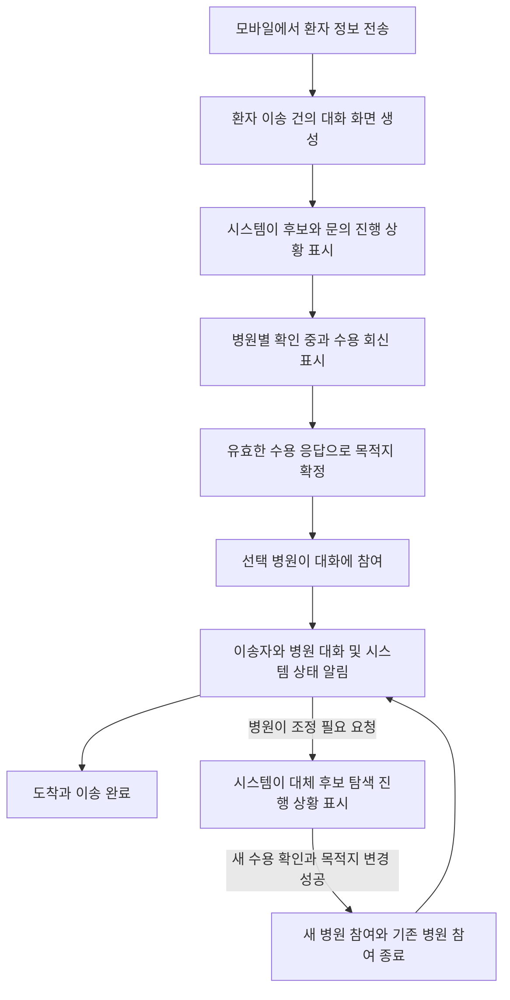

# 환자와 병원과 시스템의 대화 흐름

환자 이송 건마다 하나의 대화 화면을 두고, 병원 탐색부터 이송 완료까지 진행 상황을 이어서 보여준다. 탐색 중에는 시스템이 문의·회신 상태를 알리고, 목적지 확정 후에는 선택된 병원이 참여해 이송자와 대화한다. 서버는 상태 알림과 메시지 전달을 담당하는 시스템 참여자로 표시한다.

2026년 10월 12일 설계안이다. 같은 날 서버의 자유채팅 저장·대화 API·병원 참여 구간을 구현했다. 양쪽 화면 연결은 남아 있다. 호출 방법과 현재 구현 계약은 [대화 API 명세](../CHAT_API.md)를 따른다.

## 사용자가 보는 흐름

| 단계 | 참여와 표시 | 화면 예시 |
|---|---|---|
| 환자 등록 | 이송자와 시스템. 입력한 환자정보 요약을 상단에 고정 | “환자정보가 등록됐습니다.” |
| 후보 탐색 | 시스템 진행 카드. 병원별 문의 상태를 묶어 표시 | “A·B·C병원에 수용 문의를 등록했습니다.” |
| 병원 회신 | 실제 회신에 따라 상태 갱신. 회신과 확정을 구분 | “A병원: 확인 중 / B병원: 수용 가능 / C병원: 수용 불가” |
| 목적지 확정 | 기존 확정 API 성공 후 선택 병원이 참여 | “B병원으로 목적지가 확정됐습니다. B병원이 대화에 참여했습니다.” |
| 이송 | 병원과 이송자의 자유메시지, 시스템의 출발·ETA·변경 알림 | “이송자: 출발했습니다.” / “병원: 전달받은 정보를 확인했습니다.” |
| 조건 변경 | 병원의 구조화된 조정 요청을 시스템이 알림 | “B병원에서 조정을 요청했습니다. 기존 목적지를 유지하며 대체병원을 확인합니다.” |
| 재배정 | 새 수용 확인과 목적지 변경 성공 시 참여 병원 교체 | “C병원으로 목적지가 변경됐습니다. C병원이 참여했습니다.” |

탐색 상태는 병원별 진행 카드 하나를 갱신하고, 실제 회신·확정·변경을 주요 사건으로 남긴다. 같은 대기 안내를 매 조회마다 새로운 말풍선으로 쌓지 않는다.

## 병원 참여와 기록 범위

여러 병원이 수용 가능으로 회신할 수 있으므로 `ACCEPTED`만으로 공동 대화에 참여시키지 않는다. `confirm_destination()` 성공과 같은 DB 트랜잭션에서 선택 병원의 참여 구간을 연다. 확정 전 후보 병원은 기존 문의 화면에서 자기 문의와 환자정보를 확인한다. 추가 질문은 기존 질문·답변 기능을 통해 전달한다.

병원이 조정 필요를 요청해도 기존 병원의 참여를 즉시 끝내지 않는다. 새 병원의 유효한 수용 확인과 `change_destination()` 성공 시 기존 참여 구간 종료와 새 참여 구간 생성을 함께 반영한다. 모바일에서는 대화 화면을 유지한다.

기존 병원은 자기 참여 구간의 기록을 조회하고 이후 새 병원과의 대화는 보지 않는다. 새 병원에는 최신 환자정보·이송 상태·변경 사유·인계 요약을 제공한다. 다른 병원과의 자유대화 전체를 자동 공개하지 않는다. 이송자는 자신의 전체 이력을 이어서 확인한다.

현재 로그인 없는 시연 조건에서는 병원 ID와 현재 참여 구간을 서버에서 검사한다. 이는 로그인된 실제 담당자의 신원을 검증하는 접근 통제 구현을 뜻하지 않는다.

## 시스템 알림과 자유대화의 처리

| 종류 | 원본과 처리 |
|---|---|
| 문의 등록·회신·확정·출발·조정·목적지 변경 | 기존 `events`와 현재 업무 상태를 정해진 문구로 변환한다. 실제 발생한 사건만 표시한다. |
| 이송자와 병원의 자유메시지 | 별도 메시지 저장소에 작성자·병원·참여 구간·시각·내용을 저장한다. |
| 수용·불가·확정·출발·조정 | 채팅 카드 안의 구조화된 버튼으로 기존 업무 API를 호출한다. 성공 결과를 시스템 메시지로 표시한다. |
| 환자 상태나 치료조건 변경 | 별도 정보 수정 동작으로 처리한다. 자유문장을 읽었다는 이유만으로 알고리즘 입력을 바꾸지 않는다. 이송 중 수정 API는 별도 구현 범위를 확인한다. |

“받을 수 있습니다”라는 자유메시지만으로 `ACCEPTED`를 만들지 않는다. 병원이 수용 버튼을 눌러 기존 응답 API가 성공해야 한다. 목적지 확정도 동일하게 기존 자원 충돌·만료·버전 검사를 통과해야 한다.

`PENDING`은 서버에 문의가 등록됐다는 뜻이다. “병원이 확인 중”은 실제 `checking` 회신이 있을 때만 표시한다. 현재 열람 확인 기능이 없으므로 “읽음”이나 “의료진이 검토 중”을 추정해서 표시하지 않는다.

기존 `inquiries.question/answer`는 질문과 답변 한 쌍을 보관하며 새 질문 때 이전 내용이 덮어써진다. 전체 대화 이력으로 사용할 수 없다. 질문·답변 이력도 보존하려면 원문 스냅샷을 별도 기록해야 한다.

## 추가할 저장 구조와 API

다음 저장 구조와 API는 서버에 구현했다. 세부 필드·페이지 조회·오류 처리는 [대화 API 명세](../CHAT_API.md)를 참고한다.

| 저장 구조 | 핵심 필드와 역할 |
|---|---|
| `conversations` | `id`, `patient_id` 고유 연결, `state`, `created_at`, `closed_at`. 환자 이송 건당 하나 |
| `conversation_hospital_sessions` | `id`, `conversation_id`, `hospital_id`, `inquiry_id`, `joined_at`, `left_at`. 재배정 전후 병원 참여 구간 |
| `chat_messages` | `id`, `conversation_id`, `hospital_session_id`, `sender_role`, `sender_name`, `body`, `created_at`, `client_message_id`. 자유메시지와 전송 중복 방지 |

시스템 업무 사건은 기존 `events`를 원본으로 사용한다. 화면에서는 사건과 자유메시지를 함께 정렬하되 `event:123`, `message:45`처럼 항목 ID를 구분한다. 커서도 사건 ID와 메시지 ID를 별도로 관리해 재조회 시 누락과 중복을 막는다. 최근 20개 알림만 있는 환자 상세 응답을 전체 채팅 이력으로 사용하지 않는다.

| 동작 | 제안 경로 |
|---|---|
| 모바일 대화 조회 | `GET /api/patients/{pid}/conversation` |
| 모바일 메시지 전송 | `POST /api/patients/{pid}/messages` |
| 병원 대화 조회 | `GET /api/hospitals/{hid}/patients/{pid}/conversation` |
| 병원 메시지 전송 | `POST /api/hospitals/{hid}/patients/{pid}/messages` |

작성자 역할·참여 병원·전송 가능한 상태는 서버에서 결정하고 검증한다. 메시지 본문의 역할 값만 믿어 시스템 알림을 작성하거나 다른 병원으로 발신할 수 있게 하지 않는다. 자유메시지 작성은 환자 입력 버전이나 배정 재계산 버전을 바꾸지 않는다.

첫 버전은 기존처럼 3초 간격 조회를 사용한다. 보낸 메시지는 저장 성공 응답으로 즉시 반영하고 상대 화면은 다음 조회에서 갱신한다. 연결이 끊기면 재연결 상태를 표시하고, 같은 `client_message_id`로 재전송해 중복 저장을 막는다. 읽음·접속 중·입력 중 표시는 첫 구현 범위에서 제외한다.

## 담당자별 구현 순서

| 담당 | 맡길 작업 | 완료 기준 |
|---|---|---|
| 서버 담당 | 기존 사건의 표시 계약, 대화·메시지 저장, 참여 구간, 조회·전송 API | 문의부터 병원 참여·재배정까지 업무 상태와 대화 참여가 일치. 중복 전송·재접속·구간별 조회 확인 |
| 모바일 담당 | 환자정보 전송 후 대화 화면, 병원 진행 카드, 시스템 메시지, 자유대화, 확정·출발 버튼 | 새로고침 후 같은 이송 건의 기록 복구. 회신과 확정을 구분하고 선택 병원 메시지 표시 |
| 병원 담당 | 기존 문의함 유지, 확정 환자의 대화 진입, 자유대화, 수용 유지·조정 버튼 | 확정된 환자와 대화하고 조정 결과가 모바일에 반영. 재배정 후 새 메시지 발신 차단 |

첫 통합은 기존 사건을 채팅 형태로 보여주는 데서 시작한다. 다음으로 목적지 확정 후 자유대화를 붙이고, 마지막으로 재배정 시 병원 참여 전환을 검증한다. 환자정보 입력부터 모든 기능을 자연어로 처리하는 챗봇은 이번 구현 목표에 포함하지 않는다.
