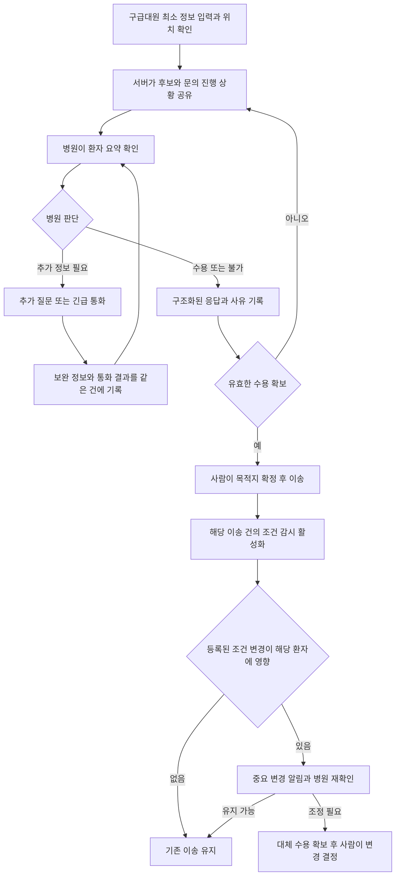

# 응급환자 병원 배정 프로젝트 피어리뷰 분석과 개선 계획

작성일: 2026년 10월 28일

10월 29일 서버 반영: [응답 관측 수정·업무 계측·중요 사건 확인 API](../BACKEND_MEASUREMENT_API.md)를 구현했다. R8의 환자 건별 작업 계측 기반과 R5의 수신·인지 확인 기반을 제공한다. 팀원 화면 연결·OS 푸시·실제 사용자 인증은 별도 과제로 남는다.
R3의 서버 기반으로 [통화 결과 기록·상대 기관측 내용 확인·정정 API](../CALL_RECORD_API.md)도 추가했다. 통화 메모와 실제 수용·조건 재확인 처리는 구분한다.

이번 피드백의 핵심은 **서비스의 필요성에는 공감하지만, 실제 구급대원과 병원의 업무가 줄어드는지는 충분히 설득되지 않았다**는 것이다. 사용 편의·입력·가독성 관련 지적은 22건 중 13건, 전화와 채팅의 역할에 관한 지적은 8건이었다.

개선의 우선순위는 기능 수보다 업무 흐름에 둔다. **초기 입력과 화면을 단순화하고, 긴급 통화와 시스템 기록의 역할을 나누며, 병원의 중복 확인·검토를 줄이는 방향**을 권장한다. 알고리즘 성능과 별도로 양측의 활동시간과 오류를 측정해야 한다.

## 1 분석 범위와 해석

- 원자료: 팀에서 제공한 `5조 캡스톤 피어리뷰.xlsx`, `5조!A1:B22`. 원본 평가 파일은 저장소에 포함하지 않는다.
- 구성: 조교 피드백 1건, 학생 피드백 21건. 점수 자료는 없다.
- 방법: 의견을 의미별로 수작업 분류했다. 한 의견에 여러 주제가 포함되므로 범주별 건수는 중복되며 합계가 22를 넘는다.
- 아래 건수는 발표 피드백의 주제 빈도다. 실제 구급대원·의료진의 사용성 실험이나 현장 장애 발생률을 뜻하지 않는다.
- 구현 상태는 10월 28일 소스와 실험 문서를 기준으로 확인했다. 본 문서는 개선 제안이며, 앱·병원 웹·서버의 동작을 변경한 것은 아니다.

## 2 피드백을 묶어서 본 결과

| 주제 | 건수 | 주요 내용 | 반영 방향 |
|---|---:|---|---|
| 사용 편의·입력 조작·가독성 | 13 | 급한 상황에서 입력이 많고, 화면의 글이 많아 핵심이 잘 보이지 않음 | 초기 요청에 필요한 정보와 후속 보완 정보를 분리. 현재 상태와 다음 행동을 우선 표시 |
| 전화 흐름·채팅 대체 | 8 | 처치 중 타이핑이 부담이고, 전화가 주는 즉각적 확인을 채팅이 대신할 수 있는지 의문 | 긴급 통화 유지. 시스템은 공통 환자 요약·문의 진행·응답·재확인 기록을 담당 |
| 근본 해결력·구조적 한계 | 6 | 의료진·병상이 부족하거나 병원이 응답하지 않으면 같은 문제가 남음 | 자원 부족 해소와 소프트웨어 기여를 분리. 자원 전무·무응답 상황도 실험 |
| 병원 정보 갱신·응답 업무 | 4 | 상태 갱신, 요청 확인, 채팅이 병원에 추가 업무가 될 수 있음 | 상시 전체 갱신 요구를 줄이고, 관련 환자만 재확인. 병원 총 활동시간 측정 |
| 기존 시스템과의 차별·비교 | 3 | 이미 병원 탐색·동시 요청 시스템이 있는데 추가 기여가 불명확함 | 공통 기능과 연구 기여 분리. 문의 정책·공동 배정·확정 후 영향 판단을 별도 비교 |
| 보안·책임·권한·장애 | 2 | 개인정보, 수용 철회, 확정 주체, 통신 장애 시 대응이 불명확함 | 사용자 인증·권한, 업무 상태와 채팅의 분리, 장애 시 미전달 표시와 복구 절차 |
| 주제·필요성·기획에 대한 긍정 | 14 | 사회적으로 필요한 문제이고 사례·기획 의도에 공감 | 문제 제기는 유지하되 주장 범위를 탐색·확인 업무 지원으로 구체화 |
| 알고리즘·데이터·공학적 접근에 대한 긍정 | 5 | 조건별 데이터와 배정 알고리즘, 응답·이동시간 비교를 긍정 평가 | 알고리즘의 입력·제약·선택·실험 결과를 화면과 수치로 설명 |

가장 먼저 대응할 대상은 **사용 편의와 업무 중복**이다. 차별성 설명만 강화하고 실제 입력·통화·갱신 업무를 그대로 두면 같은 지적이 반복될 가능성이 크다.

공학적 가치에 대해서는 긍정과 부족하다는 의견이 함께 있었다. JSON 전송 자체를 기여로 설명하기보다, 어떤 제약과 불확실성 아래에서 어떤 선택을 계산하고 어떻게 검증했는지 보여줘야 한다.

## 3 해결할 문제의 범위

| 문제 | 성격 | 프로젝트가 할 수 있는 일 | 남는 제약 |
|---|---|---|---|
| 전문의·병상·장비 자체가 없음 | 의료 자원 문제 | 확인된 조건과 미확인 조건을 구분하고 다른 후보 탐색을 지원 | 필요한 자원을 새로 만들거나 치료 가능성을 보장할 수 없음 |
| 바쁜 의료진이 요청을 확인하지 못함 | 인력·업무 운영과 소프트웨어가 함께 관여 | 중복 검토 억제, 요청 취소 전달, 문의 분산, 간단한 응답 지원 | 응답할 인력이나 시간을 소프트웨어만으로 확보하지 못함 |
| 입력·재설명·중복 연락이 많음 | 소프트웨어와 사용 흐름 문제 | 입력 재사용, 공통 요약, 통화 결과 기록, 상태 공유 | 실제 업무가 줄었는지는 사용 실험이 필요 |
| 어떤 후보에 얼마나 문의하고 기다릴지 판단 | 지침·의료 판단과 계산 지원 문제 | 허용된 정책 안에서 문의·확대·확정 규칙을 비교 | 시스템이 독자적으로 의료 판단이나 선정 권한을 갖는 것은 아님 |
| 수용 확정 뒤 관련 치료 조건이 달라짐 | 의료 상황 변화와 정보 전달 문제 | 등록된 변화의 환자별 영향 식별, 재확인, 대체병원 탐색 지원 | 미등록 변화를 자동으로 알아내지 못하며 실제 수용은 병원의 판단이 필요 |

프로젝트 목표는 **주어진 의료 자원과 관측 가능한 정보 안에서 병원 탐색·확인·배정·조건 재확인에 드는 부담을 줄이는 것**으로 정리한다. 모든 응급실 미수용을 해결한다는 주장보다 검증할 대상을 명확히 할 수 있다.

## 4 개선 대안 비교

| 대안 | 구체적인 변경 | 장점 | 비용과 한계 | 권장 판단 |
|---|---|---|---|---|
| A 입력과 화면 단순화 | 초기 입력 축소, 상세 정보 단계적 보완, 상단 상태 요약, 구조화된 응답 버튼 | 현재 구조를 활용해 빠르게 개선 가능 | 통화·앱 이중 업무와 무응답은 별도로 남음 | 즉시 적용할 우선안 |
| B 통화와 시스템의 역할 분담 | 긴급 확인은 통화, 환자 요약·진행 상황·응답·변경 기록은 공통 화면으로 공유. 통화 결과는 같은 이송 건에 한 번 기록 | 기존 소통 방식을 유지하면서 재설명·재문의·중복 기록을 줄일 가능성 | 누가 통화 결과를 기록하고 상대가 어떻게 확인하는지 설계 필요 | 기본 운영 방향으로 권장 |
| C 음성 입력과 외부 연계 | 짧은 음성 메모를 입력 초안으로 변환하고 사람이 확인. 향후 기존 구급 기록·병원 시스템 연계 검토 | 타이핑과 재입력을 줄일 가능성 | 인식 오류·검수·연계 권한·개인정보 처리 부담. 자동화가 오히려 수정 작업을 늘릴 수 있음 | 별도 실험 후 선택 |

**A를 먼저 적용하고 B를 기본 흐름으로 정리한다.** C는 가상 환자와 모의 음성으로 입력시간·수정량을 비교한 뒤 결정한다. 실제 긴급 통화의 자동 녹음·요약이나 병원 EMR 연계를 현재 계획의 필수 전제로 두지 않는다.

### 권장 흐름

문의 진행과 도착 전 재확인 흐름은 이미 구현된 기능을 활용한다. 현재 조건 감시는 이송 건별로 명시적으로 활성화한 경우에 동작한다. 위 흐름에서 통화 결과의 확인 방식, 중요 알림의 인지 확인, 최소 입력 화면은 보완 과제다.

## 5 현재 기능과 개선 작업 구분

| 항목 | 10월 28일 현재 확인된 상태 | 개선할 부분 |
|---|---|---|
| 문의 진행과 응답 표시 | 서버 사건과 대화 타임라인 구현 | 많은 메시지를 읽지 않아도 현재 상태·다음 행동이 보이는 요약 |
| 수용·불가·확인 중·추가 질문 | 업무 응답과 질문 처리 구현 | 응답 버튼·사유 선택의 조작 수와 오해 가능성 검증 |
| 병원과 구급대의 대화 | 목적지 확정 후 병원 참여, 변경 시 참여 구간 구분 | 긴급 통화·구조화 응답·자유 대화의 역할 정리 |
| 확정 후 조건 재확인 | 확정 조건 보존 구현. 명시적으로 감시를 켠 이송 건에서 환자별 영향 판단·병원 유지/조정·대체 문의 처리 | 누가 언제 알았는지 확인하고 미확인 중요 변경을 전달 |
| 화면 갱신 | 현재 폴링 방식. 구급대 화면은 탭이 숨겨지면 갱신 중지 | 화면 밖 전달과 복귀 동기화. 서버 실시간 연결만으로 OS 푸시가 되는 것은 아님 |
| 이송 중 위치 | 위치 갱신 API와 수동 좌표 전송 구현 | 담당 앱의 최초 위치 확인 기능과 연결하고 지속 갱신·수동 대체 검토 |
| 외부 유입 환자 | 서버 목록·상세·퇴실·정합성 API와 병원 웹의 유입 등록 구현 | 기존 API를 활용한 목록·종료·정합성 확인 화면 연계 |
| 인증과 접근 권한 | 병원 참여 구간·업무 검증은 있으나 실제 사용자 인증을 대신하지 않음 | 계정·소속 병원·이송 건 단위 권한과 접근 거부 검증 |

따라서 “채팅 기능 개발”, “조건 변화 감지 기능 개발”, “외부 유입 API 개발”을 그대로 신규 과제로 잡지 않는다. 이미 있는 기능의 노출·전달·운영 검증을 개선 작업으로 분리한다.

## 6 우선 구현할 개선 요구사항

다음 완료 기준은 개발 검수 기준이다. 임상 안전성이나 현장 성과가 검증됐다는 의미는 아니다.

| ID | 우선순위 | 개선 작업 | 완료 확인 방법 |
|---|---|---|---|
| R1 | P0 | 초기 입력과 상세 보완 분리. 위치·주요 상태·필요 치료 조건 중 시나리오에 필요한 정보를 우선 구성 | 동일 시나리오에서 요청 시작까지의 활동시간·조작 수·누락을 현재 화면과 비교. 필수 항목은 현장 검토 대상으로 명시 |
| R2 | P0 | 현재 단계·문의/검토/최종 회신 건수·수용 후보·다음 행동을 한 화면에 요약 | 사용자가 전체 채팅을 읽지 않고 현재 상태와 다음 행동을 정확히 설명하는지 과업 평가 |
| R3 | P0 | 통화와 시스템 기록 연결. 통화 결과의 작성자·상대·시각·확인 상태 보존 | 구급대의 전달 기록, 병원 직접 응답, 수용 확정을 구분. 통화 메모와 자유채팅만으로 목적지가 바뀌지 않음 |
| R4 | P0 | 병원 중복 검토 축소. 취소된 요청 표시·응답 동작 중지·이미 기록된 요약 재사용 | 다른 병원 확정 후 남은 문의가 취소된 것을 담당자가 식별하고, 오래된 창에서 확정되지 않는지 확인 |
| R5 | P0 | 중요 변경 알림·사용자 확인·복귀 후 동기화 | 사건 등록→화면 표시→사용자 확인 시각 기록. 숨김 탭·오프라인·재접속에서도 미확인 상태를 유지. 재알림은 중복을 제한 |
| R6 | P0 | 불확실한 정보와 미응답을 명확히 표시 | 모름·미응답을 불가 또는 수용으로 바꾸지 않음. 확인된 부적합과 추가 확인 필요를 구분 |
| R7 | P0 | 실제 사용자 인증과 사건별 접근 권한 | 다른 병원·다른 이송 건 접근 거부, 권한 없는 응답·메시지 거부, 로그의 민감정보 최소화 확인. 외부 접근을 여는 배포 전에 적용 |
| R8 | P0 | 입력·열람·검토·응답·재확인·통화 기록 등 업무 계측 | 자동 대기시간과 사용자가 실제 작업한 시간을 구분하고 양측 결과를 계산할 수 있음 |
| R9 | P1 | 위치 갱신과 도착 정보 연계 | 위치 갱신 시각과 오래된 위치 표시, 연속 갱신 실패 시 수동 대체. 위치 수집 범위는 팀 합의 |
| R10 | P1 | 외부 유입 관리 화면 연결 | 등록된 유입을 조회·종료하고 자원 반영을 확인. 기존 API를 재사용 |
| R11 | P1 | 알고리즘 채택 기준 보강 | 선정·도착·미배정·개별 지연·병원 업무를 함께 비교하고 악화 사례를 보존 |
| R12 | P2 | 음성 메모 입력 실험 | 가상 정보로 수동 입력과 비교. 전체 입력+수정시간과 오류가 유리할 때만 후속 채택 |

R5는 현재 폴링에 무엇을 추가할지 단계적으로 결정한다. 먼저 화면 내 강조·확인 기록·재접속 복구를 검증하고, 필요한 범위에서 서버 이벤트 전송과 Web Push 또는 앱 알림을 연계한다. 서버에 사건이 기록됐다는 사실과 사용자가 인지했다는 사실을 별도로 다룬다.

병원 문의함 정렬은 단순한 선착순이나 실험용 우선순위를 임상 기준으로 적용하지 않는다. 표시·취소 전달부터 개선하고, 임상적 긴급성과 운영 기준을 검토한 뒤 정렬 정책을 비교한다.

## 7 병원 업무 부담을 줄이는 방법

병원에 모든 자원 상태를 계속 입력하도록 요구하면 피드백의 우려가 그대로 남는다. 다음과 같이 반복 업무를 줄이는 방향으로 설계한다.

1. **환자 요약을 한 번 공유한다.** 문의·추가 질문·채팅에서 같은 환자 정보를 다시 입력하지 않도록 재사용한다.
2. **환자별 응답을 해당 시점의 판단 근거로 보존한다.** 특정 환자를 받을 수 있다는 응답을 병원 전체의 무제한 수용 가능 상태로 확대하지 않는다.
3. **더 이상 유효하지 않은 문의는 종료됐음을 알린다.** 서버의 취소 처리와 병원 담당자의 인지를 연결해 중복 검토를 줄인다.
4. **변경과 관련된 환자만 재확인한다.** 신규 환자용 잔여 병상이 0이 된 것과 기존 수용 환자의 치료 조건이 깨진 것을 구분한다.
5. **채팅보다 업무 응답을 우선한다.** 수용·불가·추가 질문·수용 유지·조정 필요는 구조화된 상태로 관리하고 자유 대화는 보충 설명에 사용한다.
6. **응답하지 못한 상태도 다음 절차로 연결한다.** 재문의·다른 후보·통화·상황실 지원 중 적용할 절차를 정하되, 응답을 강제할 수 있다고 가정하지 않는다.

병원 부담은 다음 활동시간을 합쳐 평가한다. 동시에 수행한 작업을 중복 합산하지 않도록 측정 기준을 정한다.

> 병원 총 활동시간 = 요청 확인 + 정보 검토 + 응답 + 상태 갱신 + 추가 질문 + 재확인 + 채팅·통화 + 중복 기록에 실제 사용한 시간

알고리즘에서 문의 수가 줄었다고 실제 병원 업무가 같은 비율로 줄었다고 주장하지 않는다. 상태 갱신이나 재확인 업무가 늘면 전체 부담은 커질 수 있다.

## 8 검증 계획

### 8.1 사용성 평가

현재 화면과 개선 화면을 같은 과업으로 비교한다. 참가자는 구급대원 역할과 병원 역할을 수행한다. 수행 순서를 교차 배치하고 동등한 시나리오를 사용해 학습 효과를 줄인다.

| 과업 | 확인할 지표 |
|---|---|
| 환자 발생 후 최초 문의 시작 | 입력 활동시간, 조작 수, 누락·오입력, 도움 요청 횟수 |
| 문의 진행 중 현황과 다음 행동 파악 | 상태 이해 정답률, 판단 소요시간, 불필요한 재조회·재연락 |
| 추가 질문 또는 통화 후 결과 공유 | 중복 입력, 기록 오류, 양측 확인 시간 |
| 한 병원 확정 후 다른 문의 종료 | 취소 인지시간, 불필요한 검토 지속시간, 오래된 화면에서의 잘못된 처리 |
| 수용 조건 변경과 재확인 | 영향 환자 식별·인지·확인 시간, 불필요한 재확인, 목적지 오변경 |
| 탭 숨김·통신 중단·재접속 | 미전달 표시, 복구 후 상태 일치, 중복 전송·중복 확정 여부 |

첫 단계는 팀 외 동료로 형성평가를 진행해 UI 문제를 찾는다. 이후 가능하면 구급대원·응급의료기관 담당자의 검토를 받는다. 동료 평가만으로 실제 현장 편의성이나 임상 효과를 입증했다고 표현하지 않는다.

### 8.2 알고리즘과 병원 운영의 분리 비교

| 실험 | 바꾸는 요소 | 고정할 요소 | 답할 질문 |
|---|---|---|---|
| 문의 정책 비교 | 고정 1·3·5곳, 프로젝트 적응형 정책 | 초기 환자·병원·잠재 사건·물리 자원·관측 범위 | 언제 어디에 문의하는 것이 선정시간과 문의 부담의 균형을 개선하는가 |
| 배정 규칙 비교 | 회신순·이동시간 우선·공동 배정·CP-SAT | 문의 정책과 관측 조건, 제약·목적, 가능한 한 동등한 계산 예산 | 같은 정보로 자원 경합을 어떻게 해결하는가 |
| 병원 운영 비교 | 취소 전달·검토 종료, 문의함 표시·정렬 등 | 문의·배정 정책과 인력 조건 | 업무 흐름 개선만으로 어떤 효과가 생기는가 |
| 확정 후 관리 비교 | 변화 알림·재확인 기능의 적용 여부 | 같은 변화 사건, 초기 확정 조건, 이동 조건 | 영향 파악과 대체 수용 확보의 지연을 줄이는가 |

같은 잠재 환경에서 정책별 독립 세계를 실행한다. 정책 때문에 문의·자원 점유가 달라져 실제 응답이나 후속 결과가 달라지는 것은 효과에 포함한다. 모든 분기에 같은 최종 응답을 강제로 복사하지 않는다.

병원 운영 실험에서 검토시간이나 인력을 바꾸었다면 알고리즘 단독 효과와 분리한다. CP-SAT는 제약 최적화 비교군이며 실제 전국 현행 시스템을 복제한 모델로 부르지 않는다. 현행 지침·시스템의 공개되지 않은 의사결정은 가정과 민감도 분석으로 구분한다.

### 8.3 데이터와 지표

데이터셋은 단순히 개수만 늘리기보다 다음 축을 교차해 늘린다.

- 단일·순차·다수 환자 발생, 서로 다른 긴급성, 희소 자원 경합.
- 충분한 자원·자원 부족·필수 자원 전무.
- 빠른 수용·빠른 불가·느린 회신·무응답·시간이 지난 응답.
- 병원 정보가 최신·오래됨·일부 미확인인 경우.
- 신규 중증환자 유입, 수용 조건 유지, 실제 조정 필요, 관련 없는 자원 변화.
- 짧고 긴 이동, 통신 지연·단절, 취소와 확정의 동시 발생.

주 지표는 수용병원 확보율과 선정시간·도착시간, 병원 업무량이다. 평균과 함께 p95 지연, 미배정·미도착, 기존 성공 상실, 같은 환자의 악화, 불필요한 재배정과 추가 이동도 제시한다. 성공한 환자만 남겨 평균을 계산하지 않고, 관측 종료까지 미완료인 건의 처리 기준을 사전에 정한다.

개발용과 검증용 시나리오·seed를 분리하고, 정책과 판정 기준을 고정한 뒤 새 검증을 실행한다. 한 환경에서 여러 환자가 영향을 주고받으므로 통계 비교는 환경 단위 짝지은 분석을 기본으로 한다. 결과를 보고 튜닝에 사용한 검증 자료는 이후 개발 자료로 취급한다.

공공데이터 기반 병원 정보, 도로 API 기반 이동 추정, 가상 환자·응답·자원 사건을 각각 표시한다. 이들을 합쳐 실제 환자 치료 효과로 해석하지 않는다.

### 8.4 현재 결과를 반영한 채택 원칙

10월 28일 최종 배정 비교에서는 H1이 거리순보다 일반적으로 우월하다는 근거를 확보하지 못했다. 일부 경합 사례의 미배정 감소와 함께 큰 개별 지연도 관찰됐다. 후속 G2는 알려진 자료의 일부 지연을 개선했지만 새 검증에서 전체 도착시간 단축을 재현하지 못했다. 두 결과 모두 운영 기본값 변경으로 이어지지 않았다.

따라서 다음 기준을 함께 적용한다.

- 평균 개선과 별도로 미배정·미도착·특정 환자 지연을 확인한다.
- 문의 감소와 함께 병원 총 활동시간을 확인한다.
- 변경 알림은 누락 감소와 불필요한 알림 증가를 함께 측정한다.
- 채택 기준과 허용할 성능 교환은 결과를 보기 전에 정한다. 임상 지연 한계를 임의로 만들어 사용하지 않는다.
- 기준을 만족하지 못하면 후보를 유지·보류하고 실패 이유를 보고한다. 모든 알고리즘이 기존 방식보다 우월하다는 결론을 전제로 하지 않는다.

## 9 역할별 작업과 진행 순서

아래는 기존 역할을 기준으로 한 작업 배정안이다. 팀원 담당 화면의 실제 수정은 해당 담당자가 수행한다.

| 담당 | 우선 작업 | 산출물 |
|---|---|---|
| 김민석 구급대원 앱 | 초기 입력 축소, 현재 상태·다음 행동 요약, 긴급 통화와 기록 흐름, 위치·중요 알림 연계 | R1·R2·R3·R5·R9 화면안과 과업 시연 |
| 김준성 병원 웹 | 환자 요약·응답 조작 단순화, 취소 표시·검토 종료, 관련 환자 재확인, 외부 유입 관리 | R4·R5·R10 화면안과 병원 업무량 측정 |
| 정진 공통 서버·알고리즘·시뮬레이션 | 상태·통화 기록 계약, 중요 사건·확인 기록, 인증·권한, 작업 로그, 실험 기준과 비교 | R3·R5·R6·R7·R8·R11 API 계약과 검증 결과 |
| 팀 공동 | 최소 정보와 상태 의미 합의, 모의 사용자 평가, 발표 수정 | 과업 시나리오·측정표·피드백 반영 전후 비교 |

실행 순서는 다음과 같이 잡는다.

1. **기준선 기록:** 현재 화면으로 최초 요청·응답·조건 변경 과업을 수행하고 시간·조작·오류를 남긴다.
2. **업무 규칙과 API 계약 합의:** 필수 입력, `모름`, `확인 중`, `수용`, 통화 메모, 확정, 사용자 확인의 의미와 처리 주체를 정한다.
3. **세 영역 병렬 개발:** 담당자는 화면을, 서버 담당자는 계약·알림·권한·계측을 구현한다. 외부 접근 배포 전에 인증·권한을 검수한다.
4. **동일 과업 재평가:** 개선 화면과 기존 기준선을 비교하고 부담이 늘어난 부분은 수정한다.
5. **알고리즘 별도 검증과 통합 시연:** UI 개선 효과와 알고리즘 효과를 분리한 뒤 전체 흐름을 보여준다.

## 10 발표와 보고서에 반영할 내용

| 기존 설명 | 수정 방향 |
|---|---|
| 전화를 채팅으로 대체한다 | 긴급 통화는 유지하고, 반복 설명·문의 진행·응답·재확인 기록을 공통 화면으로 공유한다 |
| 병원에 동시 문의하면 응답 부담이 줄어든다 | 불필요한 문의와 중복 검토를 줄이는 설계를 비교하고, 실제 활동시간 감소를 확인한다 |
| 병원 상태를 실시간으로 파악한다 | 확보한 정보의 출처·갱신 시각·미확인 항목을 표시하고, 병원 응답으로 해당 환자의 조건을 확인한다 |
| 조건 변화 시 자동 재배정한다 | 관련 환자를 재확인하고, 새 수용 확인과 사람의 판단을 거쳐 변경한다 |
| 알고리즘이 기존 체계보다 빠르다 | 동일한 가상 환경에서 어떤 조건에서 유리·불리한지 평가하고, 실패·개별 지연도 공개한다 |

발표에서 사용할 수 있는 문구는 다음과 같다.

> 중간발표 피드백에서는 실제 현장에서 입력과 채팅이 추가 업무가 될 수 있다는 지적이 많았습니다. 이를 반영해 초기 입력을 줄이고, 긴급 통화와 시스템 기록의 역할을 구분하려 합니다. 이미 구현한 문의·수용·조건 재확인 흐름을 바탕으로 중복 설명과 검토를 줄이고, 배정 성능뿐 아니라 구급대원과 병원의 활동시간·오류까지 측정하겠습니다.

## 11 원문별 반영 추적

`B1`은 조교 피드백, `B2~B22`는 학생 1~21의 피드백이다. 아래는 원문의 요약이며 인용문이 아니다.

| 원문 셀 | 핵심 의견 | 연결 작업 |
|---|---|---|
| 5조!B1 | 추진·기획은 긍정적이나 UI가 복잡함 | R1·R2 |
| 5조!B2 | 긴급 상황에서 휴대폰 입력이 불편할 수 있음 | R1·R12 |
| 5조!B3 | 필요성에 비해 편의·신속·효율 개선이 부족해 보임 | R1·R2·R8 |
| 5조!B4 | 기존 비교, 무응답, 병원 갱신 업무, 보안 검토 필요 | R4·R6·R7·R8·R11 |
| 5조!B5 | 응답·이동 비교는 좋지만 글이 많고 사용 효율이 낮음 | R1·R2 |
| 5조!B6 | 구체적 문제 제기와 조건별 알고리즘 접근을 긍정 평가 | 문제 정의·알고리즘 설명 유지 |
| 5조!B7 | 공학적 가치는 보이나 직관성·신뢰·편의 보완 필요 | R2·R6·R8 |
| 5조!B8 | 데이터·구조 고민은 보이나 프론트 전달이 부족함 | R1·R2 |
| 5조!B9 | 근본 해결이 아니며 복잡성을 늘릴 수 있음 | 목표 범위 명시·R8 |
| 5조!B10 | 선택 항목이 많음. 전화 내용 요약을 대안으로 제안 | R1·R3·R12 |
| 5조!B11 | 처치 중 채팅 조작이 손을 묶는다는 우려 | R1·R3 |
| 5조!B12 | 데이터 설명 부족, 입력과 병원 실시간 갱신의 부담 | R1·R6·R8·데이터 출처 표시 |
| 5조!B13 | 기존 차별·개선 효과, 수용 결정 구조의 한계 설명 필요 | R6·R11·비교 범위 명시 |
| 5조!B14 | 빠르고 직관적인 UI와 요청 단순화 필요 | R1·R2 |
| 5조!B15 | 사용만으로 구조적 문제가 해결될지 의문, 가독성 부족 | R2·R8·목표 범위 명시 |
| 5조!B16 | 근본 해결력·기술 완성도에 의문, 전화 대응 보완 필요 | R3·R11·효과와 한계 설명 |
| 5조!B17 | 병원 갱신 불가와 인력 집중으로 인한 소통 불가가 맞물림 | R4·R6·R8 |
| 5조!B18 | 유선 절차와 실시간 변수의 예외 처리 반영 필요 | R3·R5·R6 |
| 5조!B19 | 전화 대응 방법을 포함할 필요 | R3 |
| 5조!B20 | 책임·권한·입력 여유·통신 장애·병행 업무 우려 | R3·R5·R7·R8 |
| 5조!B21 | 기존 탐색 시스템과 유선 중심 운영을 고려해야 함 | R3·R11·기존 기능 비교 |
| 5조!B22 | 공학적 가치 설명과 과도한 텍스트 개선 필요 | R2·R11·계산 규칙과 실험 설명 |

## 12 구현과 실험 근거

- [대화 처리](../../server/conversations.py): 시스템 사건·참여 구간·자유 메시지. 자유 메시지는 별도 수용·배정 업무 처리를 대신하지 않는다.
- [공통 업무 처리](../../server/service.py): 병원 응답·질문·목적지 확정·변경.
- [이송 조건 재확인](../../server/transport_review.py), [처리 흐름 문서](../TRANSPORT_REVIEW.md): 확정 당시 조건 저장·영향 판단·유지/조정·대체 문의.
- [서버 API](../../server/app.py): 위치 갱신·외부 유입 관리 등 기존 인터페이스.
- [치료 정보 판정](../../server/treatment_data.py): 보유·가용 정보와 미확인 조건 구분.
- 로컬 구급대원 웹 `patient-ui/index.html`, 동작 코드 `patient-ui/app.js`, 병원 웹 `hospital-ui/index.html`: 현행 화면·폴링·대화·재확인 연계의 확인 경로다. 팀원 UI는 이번 서버 변경 묶음에 포함하지 않는다.
- [최종 배정 비교 결과](../FINAL_ASSIGNMENT_RESULTS_20261028.md), [후속 지연 개선 검증](../ARRIVAL_GUARD_RESULTS_20261028.md): 연구 후보의 이득·악화·검증 범위·운영 기본값 유지.

기존 서비스 비교표에 새로운 기능 유무를 추가할 때는 공식 매뉴얼·자료의 확인 범위를 적는다. 이번 피드백만으로 특정 현행 서비스에 진행 표시·채팅·재확인이 없다고 단정하지 않는다.
